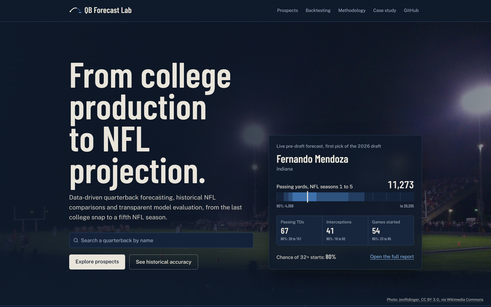

# QB Forecast Lab: frontend

The interactive scouting site for the college-to-NFL quarterback models in [`../nfl-qb-analytics`](../nfl-qb-analytics). It is
a Next.js 16 (App Router) + TypeScript (strict) app that reads everything from the project's FastAPI backend. There is no
prediction logic in this folder: every number on screen comes from an API response.



## Pages

| Route | What it does |
|---|---|
| `/` | Search, a live forecast for the newest class's first pick, the newest draft class, what a report covers, links to the evidence |
| `/prospects` | Search, draft-class filter, drafted-only filter, pagination; URL-backed so results can be shared |
| `/prospects/[id]` | The scouting report: draft projection, starting chances, five-season production with 50/80/90% ranges, season-by-season path, comparisons, warnings and limitations. `?mode=pre_draft` (default) or `?mode=post_draft` |
| `/backtesting` | One quarterback's historical forecast against his real career, labelled out-of-sample / window open / in-sample, plus accuracy across all 107 backtested quarterbacks |
| `/methodology` | Motivation and pipeline, findings, data, chronological testing, the Combine finding, starting-chance and production accuracy, bias and missing data, reading uncertainty, calibration, limitations |
| `/case-study` | Portfolio case study: problem, data, architecture, modelling, live results, findings, screenshots |
| `/credits` | Data sources, photo credits and licences, fonts and icons |

Routes use stable player ids (`qb_<n>` for drafted quarterbacks, `cfb_<cfbd id>_<final season>` for college-only ones),
never names.

## Run it locally

Two terminals:

```bash
# 1. backend (from nfl-qb-analytics/; needs the serving bundle: python -m api.bundle build)
uvicorn api.main:app --reload --port 8000

# 2. frontend (from frontend/)
cp .env.example .env.local      # NEXT_PUBLIC_API_BASE_URL=http://localhost:8000
npm install
npm run dev                     # http://localhost:3000
```

The backend's default CORS allowlist (`FRONTEND_ORIGINS=http://localhost:3000`) already matches the dev server. If you run
the frontend on another port or host, add that origin to `FRONTEND_ORIGINS` on the backend.

| Variable | Default | Notes |
|---|---|---|
| `NEXT_PUBLIC_API_BASE_URL` | `http://localhost:8000` | Public (sent to browsers). The API base URL; never a secret. |
| `NEXT_PUBLIC_GITHUB_URL` | the project repository | Header and footer link |
| `NEXT_PUBLIC_SITE_URL` | `http://localhost:3000` | Absolute URL for Open Graph previews |

No CFBD key, database or model file is ever needed here, and none must be added: anything prefixed `NEXT_PUBLIC_` ends up in
the browser bundle.

## How it talks to FastAPI

```text
browser ── fetch (GET, JSON) ──▶ FastAPI /api/* ──▶ prediction_api.Engine (serving bundle + model files)
   ▲                                   │
   └── TanStack Query cache ◀──────────┘   errors: {"error": {"code", "message", "details"}}
```

* **Typed client** (`src/lib/api/client.ts`). Endpoint types are generated from the backend's OpenAPI schema
  (`npm run gen:api` writes `src/lib/api/schema.d.ts`). `Wire<T>` marks every field present, because FastAPI serializes
  every response field (empty ones as `null`). Backend error codes become `ApiError`, plus `BACKEND_UNREACHABLE` and
  `UNEXPECTED_RESPONSE`.
* **Caching** (`src/lib/api/queries.ts`). Successful responses stay fresh for an hour, because forecasts are deterministic
  per model version. Only transient failures are retried, and only twice: unreachable, 5xx and 429. A missing prospect or
  an unsupported request is never retried. Failures are never cached as data; the next visit refetches.
* **Cold start.** The backend's first forecast loads the models (about 10 seconds). Pages show skeletons, then after a few
  seconds an honest note about the model load. There is no fake progress bar. Each forecast is requested once per
  player and mode.
* **Never synthesized.** If a request fails, the page shows the error and a retry button, and no numbers. If the API marks
  a block `unavailable`, the page shows its reason, never a zero.

**Direct calls rather than a server-side proxy.** The browser calls the API directly, for three reasons:

* The API is read-only and holds no secrets, and CORS is enforced with an explicit allowlist.
* The backend's per-address rate limiter then sees real client addresses. Behind a proxy, every visitor would share the
  proxy's address and one limit.
* There is no second hop or serverless cold start in front of the first forecast.

A proxy is worth adding only if the API origin has to be hidden or authenticated. In that case, move the base URL to a
server-only variable, add a GET-only allowlisted route handler, and forward `X-Forwarded-For` to the backend's
`--proxy-headers`.

## Forecast presentation

The five-season production section of a report reads top to bottom:

1. **Headline forecast.** Passing yards, passing TDs, interceptions, rushing yards and games started: the expected
   five-season total, its 80% range and a field ruler, in one hairline grid (five across on desktop, two on phones). A
   statistic the API does not return shows "Not available for this player", never a number.
2. **How wide is the uncertainty?** An interval chart for one statistic at a time (radio buttons; arrow keys work): the
   80% band, the 50% band inside it, the expected value as a chalk marker, an axis with units, the historical-maximum
   line where the range runs past it, and the numbers in a readout. Its accessible label spells everything out.
3. **How to read these numbers.** Four plain-language points: five-season totals, ranges are uncertainty, coverage is
   the track record, some outcomes are harder to predict (this one names the statistics that ran narrow in that view).
4. **All ten projections.** A grouped table (passing, rushing, playing time) on tablet and desktop, cards on phones.
   Column explanations are toggletips (`InfoTip`): hover, click, tap, or Enter/Space, and Escape to close.

**Honesty rules in code** (`src/lib/forecast.ts`):
* Coverage of the 80% range comes from the API (`measured_coverage.c80`, measured on 107 backtested quarterbacks).
  Below 75% it is flagged "Runs narrow" with an icon and words everywhere it appears. The comparison uses the rounded
  percentage shown, so the flag never contradicts the number beside it.
* `intervalsNested` checks that the 50% range lies inside the 80% range. The chart says so if it ever does not and
  still shows the API's numbers unchanged. An end-to-end test checks nesting for 20+ prospects in both modes against
  the live API, and another checks every card, chart label and table row against the API response.

## Logo and brand

The mark is a quarterback's throwing arc: release point and solid flight, the projected remainder as two dots, and the
landing zone drawn as a forecast range, an 80% band with its 50% core, the way the field ruler draws every range on the
site. Five concepts were sketched and rendered from 16 to 200 px; this one was chosen because it reads at favicon size
and ties the brand to the charts. The others were an arc landing on a range-and-tick cross (read as a plus sign), an arc
ending in an error bar, an arc over yard lines, and a fan chart.

| File | Use |
|---|---|
| `src/components/brand.tsx` | `Logo` (lockup, live text) and `LogoMark`, used in the header and footer |
| `public/brand/logo-horizontal-dark.svg`, `-light.svg` | standalone lockups, wordmark outlined |
| `public/brand/mark-dark.svg`, `mark-light.svg` | icon-only mark |
| `src/app/icon.svg`, `src/app/apple-icon.png`, `public/brand/icon-192.png`, `icon-512.png`, `app-icon.svg` | favicon and app icons: a heavier cut (thicker arc, one dot, taller band) for 16-512 px |
| `src/app/manifest.ts`, `src/app/opengraph-image.tsx` | web manifest and social preview, both using the mark |

`python scripts/build-brand.py . <Barlow Condensed SemiBold font file>` regenerates the SVGs. In the lockup the range
band sits on the baseline and the arc tops out at cap height.

**Palette.** Kept and tightened rather than replaced: field navy `#0F1A2B` surfaces, chalk `#E9E5DB` text, and one accent,
projection blue `#4C8BD1`, which is also the forecast colour in every chart and the logo. Amber is reserved for observed
results, yellow for caution flags. No gradients outside photo scrims, no glows. Skeletons now use the raised surface
so they show on panels.

## Photography

Six licensed photographs from Wikimedia Commons, credited on each image and on `/credits`. The full inventory, rejected
candidates and the rights reasoning are in [`ASSET_LICENSES.md`](ASSET_LICENSES.md). They live in `public/images`
and are served through `next/image` (AVIF/WebP, responsive sizes, lazy below the fold). Only images registered in
`src/lib/images.ts` are used; there are no remote images.

## Design

A film-room palette, defined as tokens in `src/app/globals.css` on a single dark theme:

* **Base colours:** field navy `#0F1A2B`, panel `#15233A`, chalk text `#E9E5DB`.
* **Data colours:** projection blue `#4C8BD1` and observed amber `#BF8530`, checked with a colour-vision-deficiency
  palette validator against the dark surface. Neutral reference grey `#7F8BA0` for baselines.
* **Type:** Barlow Condensed for names and numbers, Public Sans for text, tabular numerals.
* **The field ruler** (`src/components/field-ruler.tsx`) draws every forecast range the same way: nested 50/80/90% bands,
  a chalk tick at the expected value, an amber flag for what actually happened, and a dashed line for a historical
  maximum. Its accessible label spells out every number.
* **Charts** (Recharts) sit in `ChartFrame`, which adds a caption, a screen-reader description and a "Show data" table.

## Scripts and checks

| Command | What |
|---|---|
| `npm run dev` / `npm run build` / `npm start` | develop, production build, serve the build |
| `npm run lint` | ESLint (Next.js config) |
| `npm run typecheck` | route type generation + `tsc --noEmit` (strict) |
| `npm test` | Vitest + Testing Library + axe-core: 48 unit and component tests on synthetic, labelled fixtures (`src/test/fixtures`) |
| `npm run test:e2e` | Playwright against the **live** backend: search, reports, pre/post-draft, unsupported outputs, backtest labels, methodology, backend outage, keyboard, axe scans, no horizontal overflow on phones. Needs the API on :8000; set `E2E_BASE_URL` to test a production build |
| `npm run gen:api` | regenerate API types from the running backend |
| `node scripts/readme-shots.mjs` | regenerate `docs/screenshots` from a running app and API |

## Deploy (Vercel Hobby, free)

Live URL: https://qb-forecast-lab.vercel.app (Vercel project `qb-forecast-lab`, Hobby; production branch `main`, so pushes deploy automatically).

* **Project settings:**
  - Root Directory `frontend`; Next.js detected; `vercel.json` pins `npm ci` and `npm run build`.
  - Use the Hobby plan only, with no add-ons.
* **Environment variables:**
  - `NEXT_PUBLIC_API_BASE_URL=https://<service>.onrender.com` is required. On Vercel the build fails if it is missing
    or not `https://`, so localhost can never ship.
  - `NEXT_PUBLIC_GITHUB_URL` sets the repository link.
  - Leave `NEXT_PUBLIC_SITE_URL` unset: Open Graph URLs then use Vercel's production domain.
  - `NEXT_PUBLIC_*` values are compiled into the browser bundle, so never put a secret in one. The frontend needs none.
* **Backend:**
  - The backend runs on Render Free and sleeps after 15 idle minutes.
  - Requests time out after 75 s and retry through a wake-up: up to 5 retries, with backoff of 2, 4, 8, 15 and 15 s.
  - After 2.5 s, loading states say that the free server is waking.
  - The homepage hero, navigation, methodology text, credits and photos never wait for the API.
* **Full runbook:** `../nfl-qb-analytics/reports/deployment_readiness.md`, section "Phase 9".
* **After deploying:** run `python deploy/smoke_test.py --site <vercel url> --api <render url>` from `nfl-qb-analytics/`.

## Project structure

```text
src/app/                      routes (server components that hand off to client components)
src/components/report/        prospect report sections
src/components/backtest/      backtest view and aggregate accuracy
src/components/methodology/   methodology page
src/components/               field ruler, search, status/error states, chart frame, site chrome
src/components/ui/            shadcn/ui primitives (base-ui)
src/lib/api/                  generated schema, typed client, query hooks
src/test/                     setup, helpers and synthetic fixtures (tests only)
e2e/                          Playwright end-to-end tests against the live API
```

## Known limitations

* The serving bundle fixes the prospect list: players who are not in it cannot be searched.
* One dark theme only.
* Single-round probabilities are behind a disclosure, because the model is reliable only for round groups.
* Year-by-year forecasts are shown on reports but were never backtested, so the backtesting page shows five-season
  totals only.
* Licences for displaying CFBD- and nflverse-derived data publicly have not been reviewed. Do not deploy publicly until
  they have.
