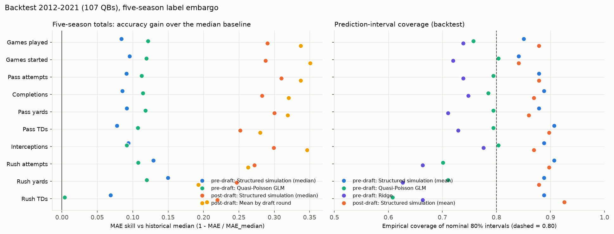

# Five-season NFL career production forecasts: evaluation

Generated by `python -m src.modeling.career_production` (backtest) and `python -m src.modeling.phase5_report` (this report). **Backtest:** test draft classes 2012-2021 (107 QBs). Each class is forecast by models trained only on classes whose five NFL seasons had been played by that draft (five-season label embargo). Hyperparameters were fixed in advance. The 2019-2021 classes were examined in earlier phases, so every number here is **exploratory**, not validated accuracy.

## Population, targets, features

* **Population:** the 183 v2 historical-eligible drafted QBs (classes 2005-2021). Each has a complete, verified five-season window. QBs verified never to have played are kept as real zeros.
* **Targets:** regular-season totals over NFL seasons 1-5. Games started come from the schedule's starting-QB fields; everything else from nflverse player stats.
* **Pre-draft features:** the 11 v2 college/context features. **Post-draft:** the same plus log(overall pick). Drafting team is not used: about 6 QBs per team over 17 seasons cannot support team effects.

| Target | Mean | Variance / mean | Share zero |
|---|---|---|---|
| Games played | 23.3 | 28 | 0.22 |
| Games started | 19.7 | 33 | 0.34 |
| Pass attempts | 654.6 | 1,095 | 0.22 |
| Completions | 401.5 | 707 | 0.23 |
| Pass yards | 4,555.4 | 8,230 | 0.23 |
| Pass TDs | 26.8 | 59 | 0.35 |
| Interceptions | 17.4 | 26 | 0.30 |
| Rush attempts | 81.2 | 206 | 0.28 |
| Rush yards | 377.5 | 1,302 | 0.30 |
| Rush TDs | 3.8 | 15 | 0.50 |

Every count is heavily overdispersed (variance far above the mean) and zero-inflated. Poisson regression is used only as a **mean** model (quasi-Poisson). No interval relies on a Poisson variance: intervals come from out-of-sample residuals or from the simulation. Negative binomial models were not fit, because `statsmodels` is not installed and sklearn has no NB estimator. The structured simulation handles overdispersion empirically instead.

## Models compared

* **Baselines:** historical mean; historical median (the MAE-optimal constant); and, post-draft only, mean by draft-round group.
* **Direct:** ridge on the raw total; quasi-Poisson GLM; boosting with Poisson loss (depth 2).
* **Two-stage hurdle:** P(meaningful opportunity, 100+ pass attempts) x E[total | opportunity] + (1 - P) x E[total | none].
* **Structured simulation:**
  * P(appear) and P(meaningful | appear).
  * For meaningful careers: models for log attempts and starts, plus completion %, YPA, TD and INT rates, rush attempts per pass attempt, rush YPC and rush TD rate.
  * Each draw takes all residuals together from one historical "donor" QB, which keeps the real dependence between volume and efficiency (no independence assumption). The donor's season-by-season shape distributes the totals over years 1-5, so there is no common growth curve.
  * Counts are drawn as integers. 1,000 draws per QB give the mean, median and 80% interval.

## Accuracy of five-season totals (MAE; lower is better)

### Pre-draft (college only)

| Target | Historical mean | Historical median | Ridge | Quasi-Poisson GLM | Boosting (Poisson loss) | Two-stage hurdle | Structured simulation (mean) | Structured simulation (median) |
|---|---|---|---|---|---|---|---|---|
| Games played | 22.8 | 21.5 | 19.9 | **18.9** | 20.2 | 20.3 | 20.7 | 19.7 |
| Games started | 22.1 | 20.6 | 19.5 | **18.1** | 19.7 | 19.2 | 20.2 | 18.6 |
| Pass attempts | 730.7 | 687.4 | 651.0 | **609.9** | 674.5 | 639.1 | 677.8 | 624.8 |
| Completions | 460.1 | 434.1 | 412.4 | **384.4** | 425.9 | 402.3 | 427.2 | 397.1 |
| Pass yards | 5,264.4 | 4,938.9 | 4,703.1 | **4,355.6** | 4,892.6 | 4,553.6 | 4,841.9 | 4,487.5 |
| Pass TDs | 32.8 | 30.3 | 29.3 | **27.1** | 30.6 | 28.9 | 30.3 | 27.9 |
| Interceptions | 17.2 | 16.2 | 15.0 | 14.7 | 15.6 | 15.3 | 16.3 | **14.7** |
| Rush attempts | 95.7 | 89.9 | 84.9 | 80.2 | 85.2 | 83.9 | 82.1 | **78.3** |
| Rush yards | 471.4 | 446.0 | 428.5 | 392.5 | 432.9 | 399.2 | 391.2 | **379.1** |
| Rush TDs | 4.9 | 4.6 | 4.5 | 4.5 | 4.7 | 4.6 | 4.4 | **4.2** |

### Post-draft (college + actual pick)

| Target | Historical mean | Historical median | Mean by draft round | Ridge | Quasi-Poisson GLM | Boosting (Poisson loss) | Two-stage hurdle | Structured simulation (mean) | Structured simulation (median) |
|---|---|---|---|---|---|---|---|---|---|
| Games played | 22.8 | 21.5 | 14.3 | **13.4** | 14.3 | 14.2 | 14.4 | 15.6 | 15.3 |
| Games started | 22.1 | 20.6 | 13.4 | **12.4** | 14.2 | 13.3 | 13.1 | 14.9 | 14.7 |
| Pass attempts | 730.7 | 687.4 | 455.7 | **424.8** | 491.4 | 449.5 | 441.8 | 437.2 | 474.3 |
| Completions | 460.1 | 434.1 | 295.0 | **277.6** | 308.1 | 293.2 | 285.6 | 281.0 | 311.4 |
| Pass yards | 5,264.4 | 4,938.9 | 3,363.4 | **3,158.3** | 3,632.8 | 3,297.6 | 3,216.8 | 3,184.9 | 3,457.2 |
| Pass TDs | 32.8 | 30.3 | 21.8 | **20.3** | 22.2 | 22.4 | 20.6 | 20.5 | 22.7 |
| Interceptions | 17.2 | 16.2 | 10.6 | **9.4** | 10.8 | 11.1 | 10.2 | 10.5 | 11.3 |
| Rush attempts | 95.7 | 89.9 | 66.3 | 67.4 | 70.4 | 67.0 | 67.1 | **65.3** | 65.5 |
| Rush yards | 471.4 | 446.0 | 360.0 | 364.0 | 368.8 | 356.8 | 345.2 | **330.3** | 335.9 |
| Rush TDs | 4.9 | 4.6 | 3.6 | 3.8 | 4.1 | 3.9 | 3.9 | 3.7 | **3.6** |

Bold = best model for that row, excluding the three baselines (historical mean, historical median, mean by round).

### Is any model better than the median baseline? (cluster bootstrap by draft class, 10 classes)

| Feature set | Target | Structured (median) vs median: MAE diff [95% CI] | P(better) | Quasi-Poisson vs median | P(better) |
|---|---|---|---|---|---|
| pre_draft | Games played | -1.8 [-3.8, +0.2] | 95% | -2.6 [-6.0, +0.8] | 92% |
| pre_draft | Games started | -2.0 [-3.8, -0.2] | 99% | -2.5 [-5.5, +0.8] | 92% |
| pre_draft | Pass attempts | -62.5 [-125.0, -4.0] | 98% | -77.4 [-182.4, +22.3] | 93% |
| pre_draft | Completions | -37.0 [-72.9, -3.0] | 99% | -49.7 [-112.7, +11.1] | 94% |
| pre_draft | Pass yards | -451.3 [-831.1, -97.3] | 100% | -583.2 [-1,347.5, +126.8] | 94% |
| pre_draft | Pass TDs | -2.4 [-4.4, -0.5] | 100% | -3.2 [-8.1, +1.3] | 90% |
| pre_draft | Interceptions | -1.5 [-3.0, -0.2] | 99% | -1.5 [-4.2, +1.2] | 86% |
| pre_draft | Rush attempts | -11.6 [-19.3, -4.1] | 100% | -9.7 [-21.9, +2.0] | 94% |
| pre_draft | Rush yards | -66.9 [-105.1, -29.9] | 100% | -53.5 [-109.0, -0.8] | 98% |
| pre_draft | Rush TDs | -0.3 [-0.8, +0.2] | 89% | -0.0 [-0.6, +0.5] | 53% |
| post_draft | Games played | -6.2 [-8.5, -4.3] | 100% | -7.2 [-9.5, -4.9] | 100% |
| post_draft | Games started | -5.9 [-8.0, -3.8] | 100% | -6.4 [-8.3, -4.4] | 100% |
| post_draft | Pass attempts | -213.0 [-290.5, -134.4] | 100% | -196.0 [-258.2, -131.7] | 100% |
| post_draft | Completions | -122.7 [-168.5, -74.8] | 100% | -126.0 [-164.2, -86.1] | 100% |
| post_draft | Pass yards | -1,481.7 [-2,012.3, -945.5] | 100% | -1,306.0 [-1,688.1, -910.9] | 100% |
| post_draft | Pass TDs | -7.6 [-10.7, -4.5] | 100% | -8.1 [-11.4, -5.0] | 100% |
| post_draft | Interceptions | -4.8 [-6.9, -2.7] | 100% | -5.4 [-7.9, -2.9] | 100% |
| post_draft | Rush attempts | -24.4 [-34.4, -14.5] | 100% | -19.5 [-30.3, -10.1] | 100% |
| post_draft | Rush yards | -110.1 [-155.1, -67.4] | 100% | -77.3 [-138.5, -23.8] | 100% |
| post_draft | Rush TDs | -1.0 [-1.4, -0.6] | 100% | -0.4 [-1.0, +0.1] | 95% |

**Reading.**
* **Pre-draft:** college features improve on the historical median for some statistics. Intervals that exclude zero for the structured model: Games started, Pass attempts, Completions, Pass yards, Pass TDs, Interceptions, Rush attempts, Rush yards. The gains are modest; college data alone cannot separate future starters from career backups very well.
* **Post-draft:** knowing the actual pick helps much more (next section).
* **Structured vs direct:** the structured simulation is the best non-baseline model for 4 of 10 pre-draft targets and 3 of 10 post-draft targets. **It does not clearly beat the simpler direct models on accuracy.** Its value is a coherent joint distribution (consistent totals, year-by-year paths, intervals), not a lower MAE.
* **Which direct model wins:** pre-draft, the quasi-Poisson GLM is best for 6 of 10 targets; post-draft, ridge is best for 7 of 10. The hurdle model is never clearly better than the direct GLM, so splitting opportunity from production does not by itself improve accuracy.
* **Mean vs median:** pre-draft, the simulation median has lower MAE than the simulation mean for 10 of 10 statistics, as expected for skewed, zero-heavy totals. Post-draft it does so for only 3: once the pick is known, the forecast distributions are less skewed. The mean is the expected value reported by the forecast function; the median is shown alongside it.

## Pre-draft vs post-draft (structured model, same QBs)

| Target | MAE pre-draft | MAE post-draft | Difference [95% CI, class bootstrap] | P(post better) |
|---|---|---|---|---|
| Games played | 20.7 | 15.6 | -5.1 [-6.9, -3.2] | 100% |
| Games started | 20.2 | 14.9 | -5.3 [-6.8, -3.5] | 100% |
| Pass attempts | 677.8 | 437.2 | -240.7 [-307.4, -169.0] | 100% |
| Completions | 427.2 | 281.0 | -146.2 [-187.0, -102.4] | 100% |
| Pass yards | 4,841.9 | 3,184.9 | -1,657.0 [-2,054.1, -1,169.8] | 100% |
| Pass TDs | 30.3 | 20.5 | -9.8 [-12.1, -6.6] | 100% |
| Interceptions | 16.3 | 10.5 | -5.8 [-7.5, -3.8] | 100% |
| Rush attempts | 82.1 | 65.3 | -16.8 [-25.1, -9.4] | 100% |
| Rush yards | 391.2 | 330.3 | -60.9 [-113.6, -17.6] | 100% |
| Rush TDs | 4.4 | 3.7 | -0.7 [-1.2, -0.3] | 100% |

Adding the actual pick reduces error for every statistic, and every interval excludes zero. The post-draft model is **not** a fair pre-draft benchmark. The pick encodes NFL teams' evaluations, and it causes opportunity: high picks are given starts. A plain "mean by draft round" baseline is already competitive post-draft (table above).

## Starter probabilities (16+ / 32+ / 64+ starts in seasons 1-5)

| Feature set | Threshold | Model | Positives / n | ROC-AUC | Brier [95% CI] | Log loss | Calibration slope | Calibration-in-the-large |
|---|---|---|---|---|---|---|---|---|
| pre_draft | 16+ | Base rate | 43/107 | n/a | 0.238 [0.214, 0.262] | 0.668 | - | +0.038 |
| pre_draft | 16+ | L2 logistic | 43/107 | 0.757 | 0.194 [0.169, 0.223] | 0.585 | 0.94 | -0.008 |
| pre_draft | 16+ | Structured simulation | 43/107 | 0.722 | 0.207 [0.181, 0.248] | 0.610 | 1.12 | +0.007 |
| pre_draft | 32+ | Base rate | 32/107 | n/a | 0.211 [0.165, 0.260] | 0.614 | - | +0.048 |
| pre_draft | 32+ | L2 logistic (= v2 configuration) | 32/107 | 0.775 | 0.165 [0.111, 0.228] | 0.507 | 0.96 | +0.013 |
| pre_draft | 32+ | Structured simulation | 32/107 | 0.736 | 0.184 [0.132, 0.242] | 0.552 | 1.43 | +0.047 |
| pre_draft | 64+ | Base rate | 15/107 | n/a | 0.128 [0.078, 0.178] | 0.464 | - | +0.078 |
| pre_draft | 64+ | L2 logistic | 15/107 | 0.601 | 0.118 [0.073, 0.165] | 0.467 | 0.24 | +0.049 |
| pre_draft | 64+ | Structured simulation | 15/107 | 0.644 | 0.120 [0.073, 0.166] | 0.419 | 0.57 | +0.064 |
| post_draft | 16+ | Base rate | 43/107 | n/a | 0.238 [0.214, 0.262] | 0.668 | - | +0.038 |
| post_draft | 16+ | L2 logistic | 43/107 | 0.881 | 0.128 [0.091, 0.170] | 0.405 | 1.13 | +0.048 |
| post_draft | 16+ | Structured simulation | 43/107 | 0.869 | 0.144 [0.108, 0.193] | 0.450 | 1.71 | +0.039 |
| post_draft | 32+ | Base rate | 32/107 | n/a | 0.211 [0.165, 0.260] | 0.614 | - | +0.048 |
| post_draft | 32+ | L2 logistic | 32/107 | 0.877 | 0.115 [0.066, 0.180] | 0.382 | 1.15 | +0.044 |
| post_draft | 32+ | Structured simulation | 32/107 | 0.880 | 0.141 [0.092, 0.207] | 0.440 | 1.78 | +0.103 |
| post_draft | 64+ | Base rate | 15/107 | n/a | 0.128 [0.078, 0.178] | 0.464 | - | +0.078 |
| post_draft | 64+ | L2 logistic | 15/107 | 0.743 | 0.100 [0.054, 0.152] | 0.386 | 0.67 | +0.064 |
| post_draft | 64+ | Structured simulation | 15/107 | 0.836 | 0.108 [0.062, 0.156] | 0.409 | 0.43 | +0.094 |

The pre-draft 32+ logistic model is the v2 configuration, re-fit inside each embargoed fold. It reproduces v2's embargoed result on a wider test window. The **direct logistic models have a lower Brier score and calibration slopes closer to 1 than the simulation's implied probabilities, at every threshold.** The forecast function therefore reports the logistic probabilities as the primary starter probabilities and the simulation's as a consistency check. The 64+ threshold has only 15 positives: its estimates are unstable and exploratory.

## Year-by-year projections (pre-draft structured model)

| Season | Stat | MAE structured | MAE baseline (historical mean for that season) | 80% interval coverage |
|---|---|---|---|---|
| 1 | Games started | 4.6 | 5.0 | 0.93 |
| 1 | Pass attempts | 155.5 | 162.1 | 0.89 |
| 1 | Pass yards | 1,073.4 | 1,097.4 | 0.92 |
| 1 | Rush yards | 89.6 | 105.1 | 0.81 |
| 2 | Games started | 5.1 | 5.7 | 0.93 |
| 2 | Pass attempts | 165.1 | 183.8 | 0.90 |
| 2 | Pass yards | 1,188.2 | 1,322.8 | 0.90 |
| 2 | Rush yards | 106.7 | 125.8 | 0.91 |
| 3 | Games started | 4.8 | 5.1 | 0.94 |
| 3 | Pass attempts | 161.8 | 171.4 | 0.91 |
| 3 | Pass yards | 1,142.7 | 1,221.3 | 0.90 |
| 3 | Rush yards | 88.2 | 106.2 | 0.84 |
| 4 | Games started | 4.7 | 4.9 | 0.92 |
| 4 | Pass attempts | 162.9 | 163.7 | 0.92 |
| 4 | Pass yards | 1,167.5 | 1,176.8 | 0.91 |
| 4 | Rush yards | 89.5 | 97.1 | 0.91 |
| 5 | Games started | 4.2 | 4.5 | 0.93 |
| 5 | Pass attempts | 145.6 | 151.3 | 0.94 |
| 5 | Pass yards | 1,056.2 | 1,101.8 | 0.93 |
| 5 | Rush yards | 79.7 | 84.0 | 0.92 |

The gains over the per-season baseline are small in every season: largest in season 2, smallest in season 4. The yearly 80% intervals are conservative (coverage 0.81-0.94). Only starts, attempts, passing yards and rushing yards were evaluated year by year.

## Efficiency (QBs with enough volume)

| Feature set | Metric | QBs with denominator | MAE structured | MAE historical mean |
|---|---|---|---|---|
| post_draft | completion_pct | 52 | 4.01 | 3.56 |
| post_draft | int_rate | 52 | 0.68 | 0.73 |
| post_draft | rush_ypc | 43 | 1.11 | 0.99 |
| post_draft | td_rate | 52 | 0.86 | 0.84 |
| post_draft | yards_per_attempt | 52 | 0.57 | 0.51 |
| pre_draft | completion_pct | 52 | 3.95 | 3.56 |
| pre_draft | int_rate | 52 | 0.71 | 0.73 |
| pre_draft | rush_ypc | 43 | 0.98 | 0.99 |
| pre_draft | td_rate | 52 | 0.88 | 0.84 |
| pre_draft | yards_per_attempt | 52 | 0.52 | 0.51 |

Pass efficiency needs 300+ attempts and rushing YPC 50+ carries. Those QBs are already selected for playing time, so efficiency forecasts apply only conditional on a real NFL role. The structured model does **not** beat the historical mean: it is worse for completion %, YPA, TD rate and rush YPC, and only marginally better for INT rate. **NFL efficiency is not predictable from these college features at this sample size**, and these forecasts should not be relied on.

## Prediction intervals (nominal 80%)

| Target | Pre: structured | Pre: ridge | Pre: quasi-Poisson | Post: structured | Post: ridge | Post: quasi-Poisson |
|---|---|---|---|---|---|---|
| Games played | 0.85 | 0.74 | 0.76 | 0.88 | 0.82 | 0.87 |
| Games started | 0.84 | 0.72 | 0.80 | 0.84 | 0.80 | 0.80 |
| Pass attempts | 0.88 | 0.74 | 0.79 | 0.88 | 0.80 | 0.81 |
| Completions | 0.89 | 0.75 | 0.79 | 0.87 | 0.79 | 0.81 |
| Pass yards | 0.88 | 0.71 | 0.79 | 0.86 | 0.78 | 0.79 |
| Pass TDs | 0.91 | 0.73 | 0.79 | 0.90 | 0.79 | 0.77 |
| Interceptions | 0.89 | 0.78 | 0.80 | 0.87 | 0.84 | 0.81 |
| Rush attempts | 0.91 | 0.66 | 0.70 | 0.90 | 0.71 | 0.75 |
| Rush yards | 0.89 | 0.63 | 0.71 | 0.88 | 0.72 | 0.77 |
| Rush TDs | 0.89 | 0.66 | 0.61 | 0.93 | 0.67 | 0.66 |

* The simulation's 80% intervals cover 84-93% of outcomes, so they are **conservative** (too wide).
* The quasi-Poisson residual intervals are close to 80% for passing statistics (0.77-0.81).
* Ridge intervals under-cover pre-draft (0.71-0.78).
* Both direct models **under-cover rushing** (0.61-0.77). Rushing residuals from earlier classes understate the spread of later, more mobile QBs.
* No interval should be read as an exact 80%.

## Bias by draft round (mean of prediction minus actual)

| Feature set | Target | Model | Round 1 | Rounds 2-3 | Rounds 4-7 |
|---|---|---|---|---|---|
| post_draft | Games started | Historical mean | -33.7 | -5.6 | +11.9 |
| post_draft | Games started | Quasi-Poisson GLM | -7.7 | -9.7 | +2.9 |
| post_draft | Games started | Structured simulation (mean) | -19.7 | -8.2 | +2.9 |
| post_draft | Pass yards | Historical mean | -8,427.9 | -1,375.4 | +2,441.3 |
| post_draft | Pass yards | Quasi-Poisson GLM | -1,966.6 | -2,671.7 | +230.8 |
| post_draft | Pass yards | Structured simulation (mean) | -2,032.4 | -1,627.0 | +532.2 |
| post_draft | Rush yards | Historical mean | -882.7 | -196.8 | +180.0 |
| post_draft | Rush yards | Quasi-Poisson GLM | -307.6 | -291.0 | +37.5 |
| post_draft | Rush yards | Structured simulation (mean) | -200.0 | -198.4 | +74.6 |
| pre_draft | Games started | Historical mean | -33.7 | -5.6 | +11.9 |
| pre_draft | Games started | Quasi-Poisson GLM | -13.1 | -2.0 | +9.9 |
| pre_draft | Games started | Structured simulation (mean) | -25.2 | -4.7 | +11.0 |
| pre_draft | Pass yards | Historical mean | -8,427.9 | -1,375.4 | +2,441.3 |
| pre_draft | Pass yards | Quasi-Poisson GLM | -3,267.4 | -848.5 | +1,743.6 |
| pre_draft | Pass yards | Structured simulation (mean) | -4,202.3 | -356.0 | +2,847.7 |
| pre_draft | Rush yards | Historical mean | -882.7 | -196.8 | +180.0 |
| pre_draft | Rush yards | Quasi-Poisson GLM | -454.1 | -181.0 | +123.4 |
| pre_draft | Rush yards | Structured simulation (mean) | -403.0 | -119.7 | +224.2 |

**Pre-draft models under-predict first-rounders and over-predict late picks.** This is expected: college data does not know who will be handed the job. Adding the pick shrinks the first-round bias of the quasi-Poisson GLM (games started -13.1 to -7.7). The structured simulation still under-predicts first-rounders by about 20 starts: its donor draws pull every forecast toward the training pool. That is one reason its point accuracy trails the direct models after the draft.

Bias by draft class (games started, structured model; positive = over-prediction): 2012: pre -26.4, post -25.5; 2013: pre +4.0, post +2.1; 2014: pre +0.5, post -4.6; 2015: pre -7.1, post -7.6; 2016: pre +3.6, post -2.2; 2017: pre +6.2, post +0.7; 2018: pre -3.0, post -5.8; 2019: pre -1.3, post -3.2; 2020: pre -3.2, post -8.1; 2021: pre -3.5, post -6.0.

## Consistency of simulated careers

Checked on every simulated season for 40 QBs x 500 draws:

| Constraint | Holds |
|---|---|
| completions le attempts | True |
| td nonneg integer | True |
| starts le games played | True |
| games le cap | True |
| zero opportunity zero production | True |
| interceptions le attempts | True |

Totals are sums of the simulated seasons by construction, and rates are derived from the simulated totals.

## What is evaluated, and what is exploratory

* **Evaluated in the backtest:**
  * five-season totals for all 10 statistics (MAE, RMSE, bias, coverage);
  * 16/32/64+ start probabilities;
  * yearly starts, attempts, passing yards and rushing yards.
* **Weakly supported:**
  * rush TDs, interceptions and the efficiency rates (small or no gain over baselines);
  * the 64+ starts threshold (15 positives);
  * yearly completions, TDs and INTs (simulated, not separately evaluated).
* **Not supported:** drafting-team effects; NFL statistics for QBs with FCS final seasons (outside training support).

## Saved artifacts

* `models/qb_career_production/v1.0.0/pre_draft.joblib` and `post_draft.joblib`: the structured simulation, direct models and threshold logits, fit on all 183 QBs.
* The structured model object embeds the training QBs' season lines, which are needed to draw donors. Like the gitignored `data/model_artifacts/.../training_paths.parquet`, it therefore contains player-level nflverse-derived data. **Decide before committing:** nflverse data is openly licensed, but if you want no player-level data in Git, add `models/qb_career_production/` to `.gitignore` and regenerate it with the command below.
