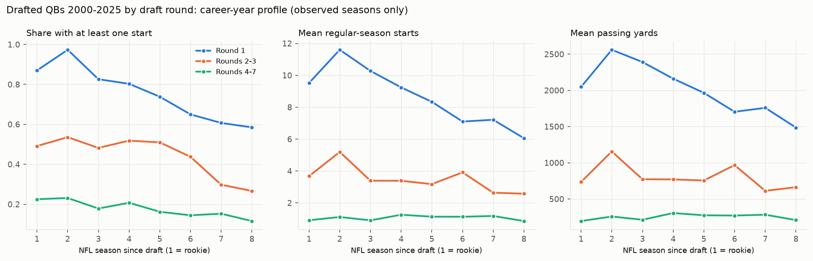
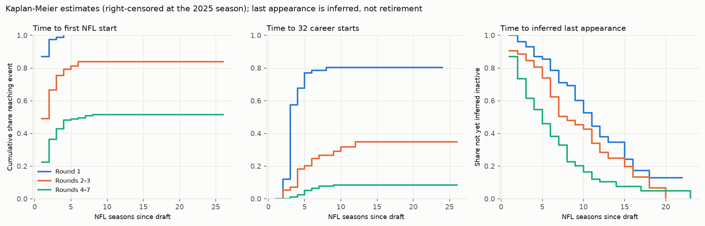

# NFL career trajectories and longevity of drafted QBs

Generated by `python -m src.modeling.career_trajectory`. **Descriptive analysis** of drafted QBs from the 2000-2026 classes, one row per QB per NFL season, observed through the 2025 regular season. Nothing here is a validated forecast; the forecasting models are evaluated in `career_production_evaluation.md`.

## Dataset

* 8,528 QB-season rows for 328 drafted QBs (every NFL season from the draft through 2025, plus not-yet-played seasons marked `future`). Status: observed 4,397, future 4,131.
* `observed` rows hold real values, and a zero is a real zero. That includes drafted QBs verified (by the draft board) to have never played. `future` rows are seasons not yet played (censored). `unverified` rows belong to QBs with no linked NFL record who are not verified as never playing; their values are left missing, not zero.
* 270 QBs have a complete, observed five-season window. Their five-season totals match the Phase-3 outcome table (mismatches: {'games_started': 0, 'pass_attempts': 0, 'pass_yards': 0}, over 270 rows).
* Consistency checks: starts <= games played True; completions <= attempts True; non-negative counts True.
* Limitation: the Phase-1 stat table keeps NFL seasons with at least 1 pass attempt. A season in which a QB only ran the ball and never threw or started counts as 0 games. Starts always count, from the schedule.

## Career-year profile by draft round

| Round group | Season | QBs observed | Share with any start | Share with 8+ starts | Mean starts | Mean pass yards |
|---|---|---|---|---|---|---|
| Round 1 | 1 | 77 | 0.87 | 0.64 | 9.5 | 2048 |
| Round 1 | 2 | 75 | 0.97 | 0.77 | 11.6 | 2561 |
| Round 1 | 3 | 69 | 0.83 | 0.68 | 10.3 | 2391 |
| Round 1 | 4 | 66 | 0.80 | 0.59 | 9.2 | 2162 |
| Round 1 | 5 | 65 | 0.74 | 0.55 | 8.3 | 1966 |
| Round 1 | 6 | 60 | 0.65 | 0.47 | 7.1 | 1704 |
| Rounds 2-3 | 1 | 59 | 0.49 | 0.24 | 3.7 | 735 |
| Rounds 2-3 | 2 | 56 | 0.54 | 0.32 | 5.2 | 1156 |
| Rounds 2-3 | 3 | 56 | 0.48 | 0.20 | 3.4 | 772 |
| Rounds 2-3 | 4 | 54 | 0.52 | 0.17 | 3.4 | 770 |
| Rounds 2-3 | 5 | 51 | 0.51 | 0.18 | 3.2 | 755 |
| Rounds 2-3 | 6 | 48 | 0.44 | 0.23 | 3.9 | 968 |
| Rounds 4-7 | 1 | 182 | 0.23 | 0.03 | 0.9 | 195 |
| Rounds 4-7 | 2 | 173 | 0.23 | 0.05 | 1.1 | 258 |
| Rounds 4-7 | 3 | 168 | 0.18 | 0.05 | 0.9 | 213 |
| Rounds 4-7 | 4 | 159 | 0.21 | 0.06 | 1.3 | 306 |
| Rounds 4-7 | 5 | 154 | 0.16 | 0.06 | 1.1 | 275 |
| Rounds 4-7 | 6 | 152 | 0.14 | 0.08 | 1.1 | 271 |

Share of QBs with at least one start, by season (seasons 1-6). **Round 1:** 87% as rookies, 97% in season 2, then down to 65% by season 6. **Rounds 2-3:** 44%-54% in every season. **Rounds 4-7:** 14%-23%. These are averages over QBs still observed. Individual paths vary widely, and a single start can be an injury fill-in.

## Time-to-event (Kaplan-Meier)

| Event | Round group | QBs | Events | Share reached by season 2 | by season 5 | Log-rank across groups |
|---|---|---|---|---|---|---|
| First start | Round 1 | 77 | 77 | 0.97 | 1.00 | chi2=125.3, p=6.2e-28 |
| First start | Rounds 2-3 | 59 | 48 | 0.67 | 0.81 | chi2=125.3, p=6.2e-28 |
| First start | Rounds 4-7 | 182 | 90 | 0.36 | 0.49 | chi2=125.3, p=6.2e-28 |
| 16 career starts | Round 1 | 77 | 68 | 0.74 | 0.90 | chi2=205.7, p=2.1e-45 |
| 16 career starts | Rounds 2-3 | 59 | 29 | 0.28 | 0.43 | chi2=205.7, p=2.1e-45 |
| 16 career starts | Rounds 4-7 | 182 | 21 | 0.03 | 0.10 | chi2=205.7, p=2.1e-45 |
| 32 career starts | Round 1 | 77 | 56 | 0.12 | 0.77 | chi2=170.5, p=9.4e-38 |
| 32 career starts | Rounds 2-3 | 59 | 17 | 0.05 | 0.20 | chi2=170.5, p=9.4e-38 |
| 32 career starts | Rounds 4-7 | 182 | 13 | 0.00 | 0.05 | chi2=170.5, p=9.4e-38 |

Shares are 1 - KM survival, so QBs still waiting (censored at the 2025 season) are handled correctly rather than counted as never reaching the event.

### Longevity (inferred)

Among 245 drafted QBs who appeared in at least one game, 166 are **inferred** inactive: no appearance in the 2 most recent observed seasons. The rest are censored. This is not a confirmed retirement, since QBs do return after a gap, and nflverse's official status field is too sparse to confirm it.

| Round group | QBs | Inferred ends | Share still appearing after 5 seasons (KM) | after 10 seasons |
|---|---|---|---|---|
| Round 1 | 77 | 38 | 0.85 | 0.53 |
| Rounds 2-3 | 53 | 36 | 0.74 | 0.43 |
| Rounds 4-7 | 115 | 92 | 0.46 | 0.16 |

Log-rank across round groups: chi2=32.9, p=7.2e-08. Round differences are associations. Draft slot buys roster time, so they are not evidence that early picks are better players.

## Why this stays descriptive

* The 2000-2004 classes have no college covariates, so a predictive survival model with college features (for example Cox) could use only the 2005+ classes. Draft round, the dominant covariate, is itself a cause of opportunity rather than a pre-draft trait. The forecasting question ("how many starts, and when?") is answered and evaluated with embargoed backtests in `career_production_evaluation.md`. Here, Kaplan-Meier curves and log-rank tests describe the history without claiming predictive validity.
* The year-by-year **forecasts** in `career_production_evaluation.md` come from a simulation model that is evaluated in chronological backtests. It draws on these same QB-season rows, used only from classes whose outcomes were observable at each forecast date.
