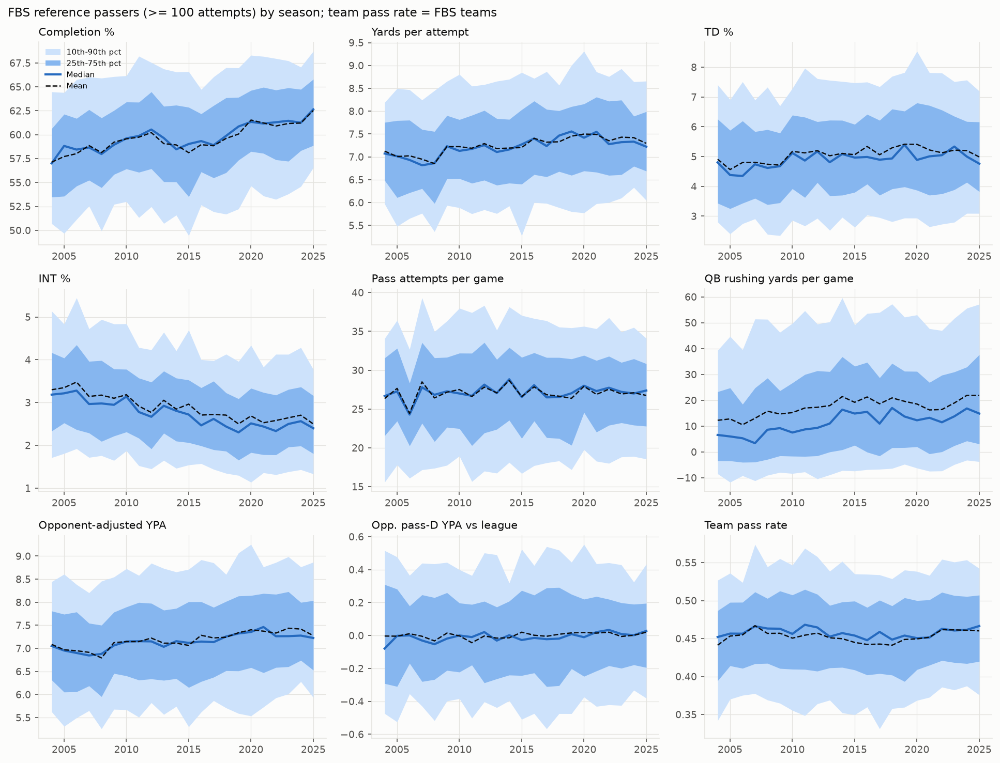
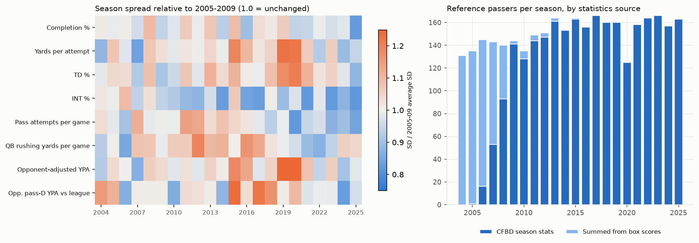
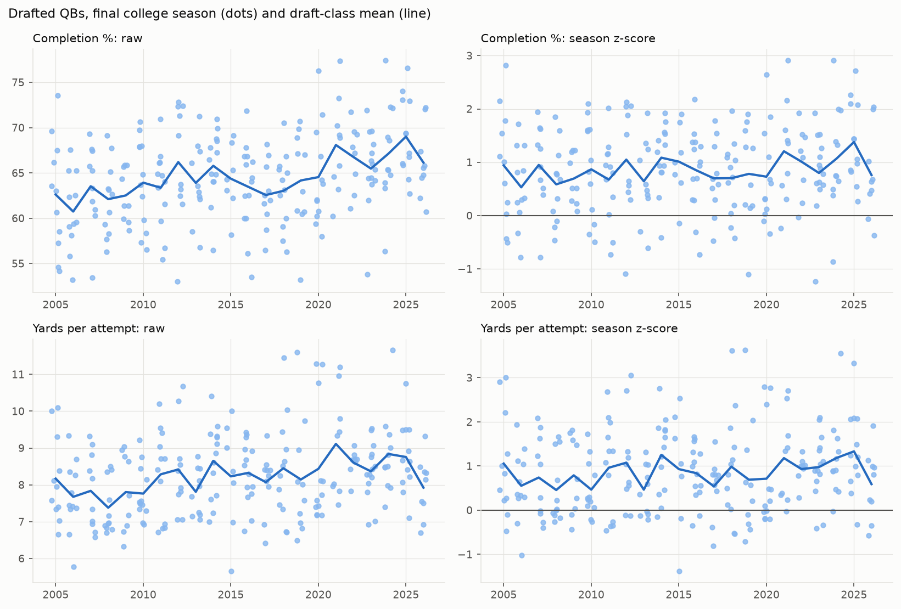

# College QB statistics across eras (2004-2025)

Generated by `python -m src.modeling.era_report`. Outcome-blind: no NFL result is used anywhere in this analysis. The reference population is every passer-season at an FBS team with at least 100 attempts and 4 games with a pass attempt. It covers 3,329 passer-seasons, 125-166 per season, built from CFBD season stats plus box-score season totals where CFBD season stats are missing (mostly 2004-2008).

## Did the distributions shift?

| Statistic | 2005-09 mean | 2021-25 mean | Shift (pooled SDs) | SD ratio late/early | Trend of yearly means (Spearman, p) | Variance explained by season |
|---|---|---|---|---|---|---|
| Completion % | 58.396 | 61.408 | +0.54 | 0.95 | +0.81 (p=0.000) | 5.4% |
| Yards per attempt | 7.013 | 7.398 | +0.35 | 0.97 | +0.84 (p=0.000) | 2.1% |
| TD % | 4.728 | 5.150 | +0.23 | 1.01 | +0.66 (p=0.001) | 1.3% |
| INT % | 3.248 | 2.590 | -0.55 | 0.86 | -0.94 (p=0.000) | 5.3% |
| Pass attempts per game | 26.826 | 27.046 | +0.03 | 0.89 | +0.08 (p=0.713) | 1.3% |
| QB rushing yards per game | 13.346 | 19.078 | +0.25 | 0.96 | +0.77 (p=0.000) | 1.7% |
| Opponent-adjusted YPA | 6.951 | 7.367 | +0.35 | 0.99 | +0.87 (p=0.000) | 1.9% |
| Opp. pass-D YPA vs league | -0.003 | 0.010 | +0.04 | 0.95 | +0.43 (p=0.047) | 0.2% |
| Team pass rate | 0.458 | 0.459 | +0.02 | 0.93 | +0.12 (p=0.608) | 0.7% |

All Kruskal-Wallis tests across seasons are listed in `results/modeling_v2/era_shift_tests.csv`. With 3,000+ passer-seasons even a trivial shift is "significant", so the effect sizes matter more than the p-values.

## Reading

* **Completion % and YPA drifted up.** Completion % moved +0.54 SD and YPA +0.35 SD from 2005-09 to 2021-25, with a monotone yearly trend (Spearman +0.81 and +0.84). A 62% passer in 2025 is close to average; in 2005 he was well above it.
* **Interceptions fell** (-0.55 SD), and opponent-adjusted YPA rose with raw YPA (+0.35 SD). The adjustment only removes opponent strength relative to the same season, not the season level.
* **QB rushing rose in level but varies a lot** (+0.25 SD). Attempts per game (+0.03 SD), TD % (+0.23 SD) and schedule strength (+0.04 SD) barely moved.
* **Season explains a small share of variance:** at most 5.4% for any statistic. Most variation is between QBs within a season. So normalization is a modest correction, not a transformation. Among the historical-eligible drafted QBs, the rank correlation between raw values and season z-scores is |rho| 0.95-1.00; for conference z-scores it is 0.69-0.95.
* **Teams did not pass more.** The FBS team pass rate is flat (+0.02 SD), so the efficiency gains are not a by-product of passing more often.
* **The spread was stable.** SD ratios are near 1, so a z-score mainly re-centres each season rather than re-scaling it.

## Not every difference is an era effect

* **Rule changes.** Attempts per game dip in 2006, when the NCAA started the clock on kickoffs and changes of possession (fewer plays). The rule was reverted in 2007. That is a real one-season environment change, and normalizing removes it, which is the intent.
* **2020.** The COVID season had shortened, uneven schedules, opt-outs and the fewest reference passers (125). It is a noisier baseline.
* **Composition.** FBS grew from 119 to 136 teams. New members change who is in the reference population.
* **Source change.** 2004-2008 seasons are mostly summed from box scores, 2009+ come from CFBD season stats (see the counts chart). There is no visible break in the series at 2008/2009, which suggests the two sources agree. But box-score coverage of games against FCS opponents can differ slightly.
* **Genuine change.** Spread and RPO concepts and better QB training may have produced genuinely more accurate passers. Season normalization cannot separate "the league got easier" from "QBs got better". It measures a QB against his contemporaries, which is what scouts compare at draft time.

## Decision

The shift in completion %, YPA and INT % (about 0.35-0.55 SD over 20 years) is large enough that raw rates from 2005 and 2021 are not interchangeable. It is small next to between-QB variation. So normalization is justified as a correction, but **it is not expected to transform predictive performance**. That is the question `reports/normalization_ablation.md` tests.

The `combo` strategy normalizes only features whose reference population shifted at least 0.3 SD. It was chosen here, before any model was fit: `cmp` -> season_z, `ypa` -> season_z, `td` -> raw, `int` -> season_z, `att_pg` -> raw, `rush_pg` -> raw, `opp_ypa` -> season_z, `sos` -> raw.

## Drafted QBs, raw vs normalized

| Draft era | Completion % raw | Completion % z | YPA raw | YPA z | Rush yds/game raw | Rush yds/game z |
|---|---|---|---|---|---|---|
| 2005-10 | 62.6 | +0.76 | 7.77 | +0.67 | 16.1 | +0.14 |
| 2011-15 | 64.7 | +0.89 | 8.30 | +0.96 | 14.5 | -0.08 |
| 2016-20 | 63.6 | +0.75 | 8.30 | +0.77 | 16.2 | -0.15 |
| 2021-25 | 67.2 | +1.08 | 8.71 | +1.12 | 22.7 | +0.22 |

Drafted QBs sit about 1 SD above the reference population in every era. Their raw completion % climbs with the league, but their season z-scores do not. Normalization removes the league-level drift while keeping each QB's standing among his peers.

## Method details

* z = (x - season mean) / season SD, clipped to +/-4.0. Season percentile = mid-rank empirical percentile among the season's reference passers. Conference z uses the (season, conference) group, the team's conference in that season; groups with fewer than 6 passers fall back to the season baseline.
* INT % and schedule strength are sign-flipped, so higher always means better (fewer interceptions, tougher schedule).
* Prospect seasons with fewer than 50 attempts get no rate score (NaN). A baseline with fewer than 2 passers or zero SD gives NaN, never 0 or infinity. Raw values are kept next to every score.
* Baselines are unweighted (each qualifying passer counts once). Attempt weighting and rolling multi-season windows are implemented and tested in `src/modeling/era.py`, but not used.
* A season-s baseline uses only season-s passers. All of those seasons ended before the next NFL draft, so normalized values are available at draft time. No NFL information enters the baselines.
