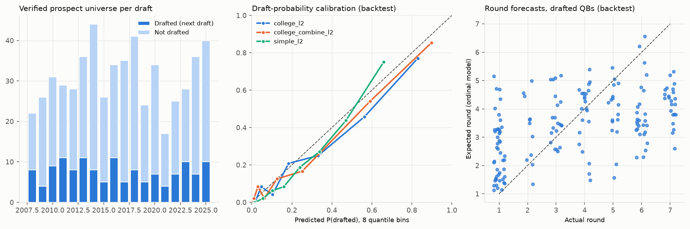

# NFL Draft projection: evaluation

Generated by `python -m src.modeling.draft_predictor`. All metrics come from **chronological backtests**: each draft class is predicted by models trained only on earlier drafts (a draft outcome is known on draft day). Hyperparameters were fixed in advance (L2 C=0.5; boosting with depth 2, 150 trees, min leaf 20). The results are exploratory, not validated accuracy.

## 1. Who could have been drafted? (the prospect universe)

The draft tables list only drafted players. "Not in the draft table" is not the same as "undrafted": it also includes QBs who returned to school, transferred down a level, or stopped playing. There is no CFBD record of draft declarations. The model is therefore trained only on QBs whose draft status can be verified from local data:

1. A passer-season with at least 100 attempts at an FBS school,
2. that is the athlete's **last appearance anywhere** in the local CFBD data (season stats or box scores), checked against the following season (so final seasons up to 2024),
3. with evidence of **at least 4 college years**: a linked high-school recruiting class at least 4 years earlier, or appearances in at least 4 distinct seasons of CFBD data. Either one makes him NFL-draft-eligible (three years removed from high school), and he did not continue in college.

**Label:** drafted in the very next draft, at any position. Drafted QBs are identified through the project's Phase-3 QB identity bridge, because CFBD's draft-pick athlete ids do **not** match its box-score athlete ids for older players (Matt Ryan is 2125735 in one and 145026 in the other). Using the pick ids alone mislabelled the entire 2008 QB class as undrafted. CFBD pick ids are used only for players drafted at other positions.

| Candidate status | Rows | Drafted |
|---|---|---|
| final_season_not_verifiable_yet | 163 | 9 |
| in_population | 556 | 138 |
| no_evidence_of_four_college_years | 394 | 62 |
| three_or_fewer_years_since_high_school | 72 | 29 |

**Population used: 556 final seasons (138 drafted), drafts 2008-2025.** Eligibility basis: recruit_class_year 301, observed_college_seasons 255. Recruiting links are sparse before about 2011, and the observed-seasons rule fills most of that gap.

**What the probability means, and what it does not.** It is P(drafted | an FBS QB's college career verifiably ended after 4+ years). It is **not** a draft probability for every college QB:
* True juniors and younger are excluded. The only way for them to leave is to declare, and undrafted early entrants cannot be identified locally.
* So are QBs with neither a recruiting link nor four observed seasons (mostly JUCO transfers and short FBS careers): the "no evidence of four college years" row.
* Two biases remain. A 4th/5th-year QB who moved to a level CFBD did not cover (FCS before 2022) or stopped playing is labelled "undrafted". And recruiting links may be more complete for higher-rated recruits.

Identity checks: 135 of 136 drafted QBs in the population are also in the drafted-QB dataset. Drafted at another position: Denard Robinson (2013, Wide Receiver), Keenan Reynolds (2016, Wide Receiver).

## 2. Draft probability (backtest, test drafts 2014-2025)

| Model | ROC-AUC [95% CI, by class] | Brier [95% CI] | Log loss | Calibration slope | Calibration-in-the-large | ECE |
|---|---|---|---|---|---|---|
| Historical draft rate | n/a | 0.177 [0.163, 0.195] | 0.541 | - | -0.033 | 0.064 |
| Simple college (YPA, attempts, power conference) | 0.868 [0.816, 0.912] | 0.118 [0.099, 0.136] | 0.371 | 1.454 | -0.028 | 0.060 |
| College features (18) | 0.878 [0.837, 0.918] | 0.115 [0.092, 0.139] | 0.357 | 0.895 | -0.033 | 0.042 |
| College + Combine (22) | 0.907 [0.864, 0.943] | 0.091 [0.072, 0.115] | 0.315 | 0.856 | -0.020 | 0.034 |
| College + Combine, gradient boosting | 0.903 [0.860, 0.938] | 0.097 [0.075, 0.125] | 0.316 | 0.956 | -0.001 | 0.024 |

384 backtest rows, 87 drafted. The confidence intervals resample whole draft classes. The Combine is a legitimate pre-draft input (it is held in late February or March), but an invitation already reflects NFL teams' opinion. "College features" is the cleaner measure of what college production alone predicts.

## 3. Draft round, conditional on being drafted

Every drafted QB from 2005-2026 with a final college passer-season in the data: 242 QBs. The age-at-draft birthdate comes from the nflverse draft board. Test drafts: 2012-2026 (166 QBs).

| Model | Log loss | Ranked prob. score [95% CI] | Top-round accuracy | Within one round | MAE, expected round | Max deviation of sum(P) from 1 |
|---|---|---|---|---|---|---|
| Historical round frequencies | 1.907 | 0.208 [0.198, 0.219] | 0.27 | 0.37 | 1.94 | 1.1e-16 |
| Multinomial logistic | 2.328 | 0.198 [0.177, 0.219] | 0.25 | 0.50 | 1.67 | 3.3e-16 |
| Ordinal, separate cumulative fits | 3.109 | 0.184 [0.163, 0.206] | 0.26 | 0.51 | 1.59 | 2.2e-16 |
| Proportional odds (added in Phase 5, see note) | 1.822 | 0.183 [0.162, 0.206] | 0.29 | 0.51 | 1.63 | 0.0e+00 |

The ranked probability score respects the order of the rounds: predicting round 2 for a round-1 QB costs less than predicting round 7.

**Note on the proportional-odds model.** The pre-specified ordinal model fits six separate cumulative logistic models. That produced incoherent distributions, for example 0.88 on round 1 and 0.09 on round 6 with almost nothing between. The proportional-odds model (one coefficient vector, ordered thresholds) was therefore added **after** seeing that defect, and it is evaluated in the same backtest. Its results are shown for transparency. Treat any preference between the two as provisional, since it was decided after looking at results.

### Overall pick range

| Model | MAE (picks) | Median abs. error | 50% interval coverage | 80% interval coverage | Mean 80% width |
|---|---|---|---|---|---|
| Ridge on log(pick), out-of-sample residual intervals | 75.5 | 50.9 | 0.464 | 0.771 | 181 |
| Historical median / 10-90% range | 74.1 | 81.0 | - | 0.741 | 211 |

Median absolute error: 51 picks, against 81 for the baseline. But the **mean** absolute error is no better (75.5 vs 74.1): the model is usually closer, and occasionally misses by 150+ picks (day-3 QBs projected early, or the reverse). The intervals are empirical, and their coverage is measured on later drafts: the 80% intervals cover 77%, slightly under nominal. Pick ranges are wide. College data separates likely first-rounders from day-3 QBs, but not pick 5 from pick 25.

## 4. Using the models together

For a prospect inside the verified universe, P(round = r) = P(drafted) x P(round = r | drafted). For anyone else (an underclassman, a walk-on, a 2025 final season), `forecast.py` returns only the conditional "if drafted" round and pick projection, and says that the unconditional draft probability is not defined for him.

## Limitations

* The universe is a verified subset, not every draft-eligible QB. Probabilities should not be quoted for early entrants.
* There is no declaration data, no all-star game data, and no pre-draft scouting rankings for undrafted players. CFBD pre-draft rankings exist only for drafted players, so they are excluded to avoid leakage.
* The round models train on about 11 QBs per draft. Rounds 2-7 each have only 1-3 QBs per year, so round-level probabilities are coarse.
