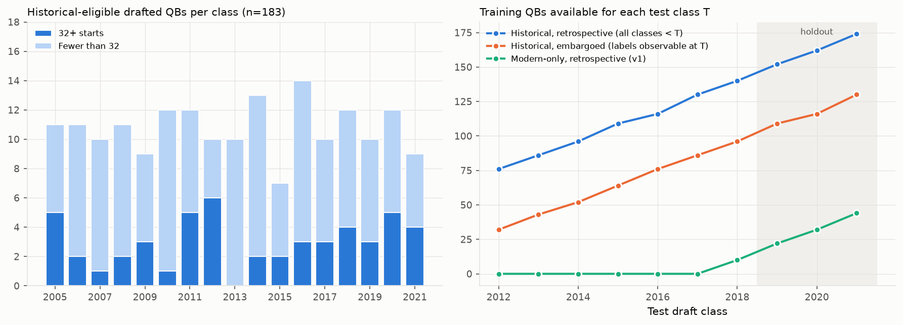
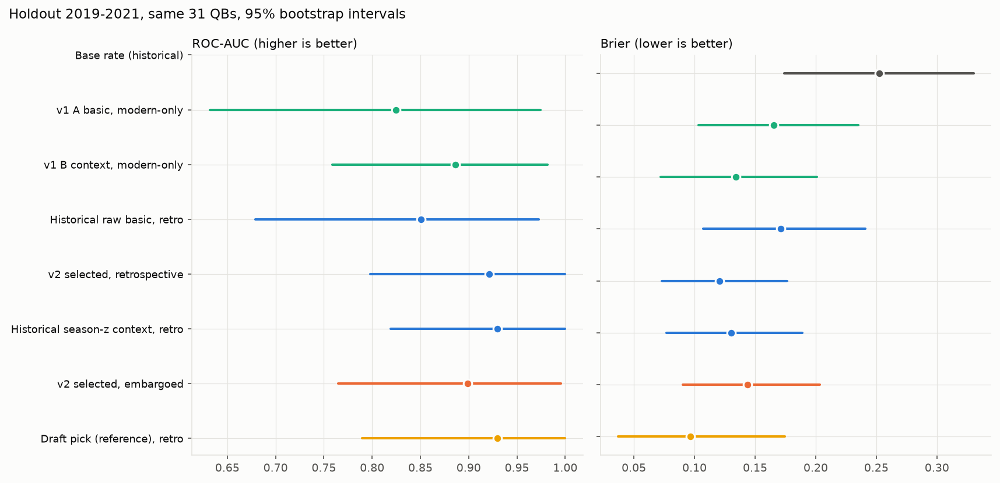
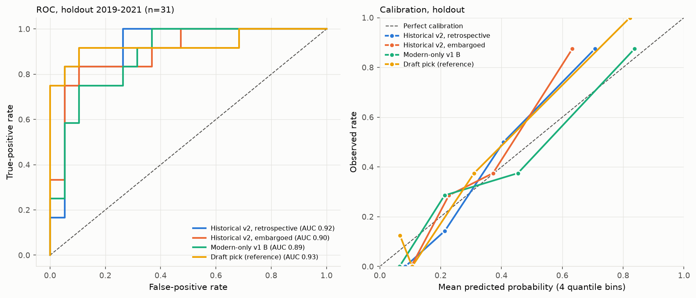
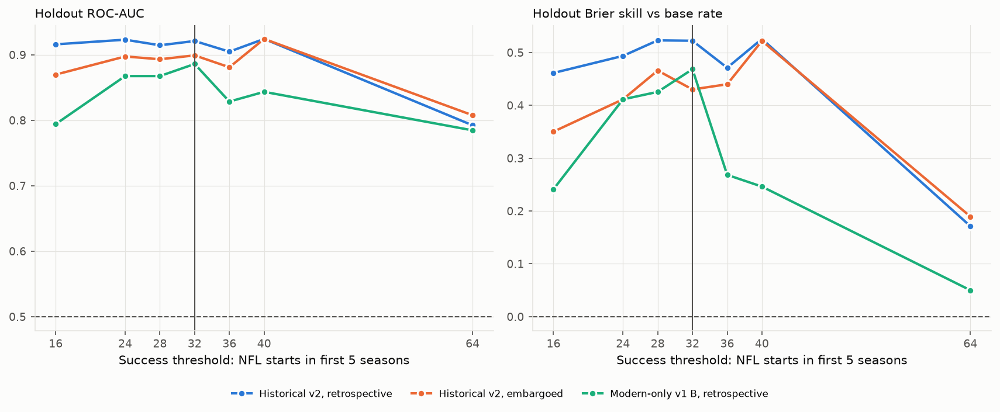
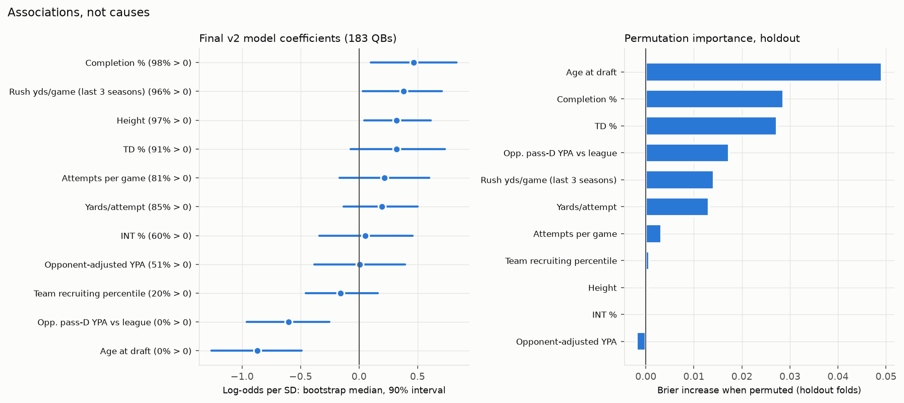

# Historical vs modern-only QB career-success models (Phase 4)

Generated by `python -m src.modeling.evaluate_v2`. All numbers are out-of-sample. Development folds are embargoed (test classes 2012-2018). The holdout is the 2019-2021 classes, restricted to the same 31 QBs v1 was evaluated on (12 reached 32 starts). Holdout results were computed only after the model was chosen on the development folds. 95% intervals are QB-level bootstraps.

## Bottom line

* **Expanding the training data helped; era normalization did not.** The pre-registered selection on development folds chose `raw|context|l2`: 11 context features in **raw units** with truncation-robust definitions, L2 logistic, trained on 183 QBs from 17 classes (2005-2021). No normalized strategy beat raw on the development folds (see `normalization_ablation.md`).
* **Holdout, retrospective regime (directly comparable to v1):** the v2 model scores AUC 0.921 [0.798, 1.000] and Brier 0.121 [0.073, 0.177]. v1 B_context, modern-only, scores AUC 0.886 and Brier 0.134. Paired difference: Brier -0.014 [-0.064, +0.035] (lower in 68% of bootstrap draws), AUC +0.035 [-0.063, +0.145]. **That is consistent with a modest improvement, but not statistically clear:** both intervals include zero.
* **Pre-registered preference rule:** v2 replaces v1 only if both its holdout Brier and log loss are lower. Result: **v2 is now the preferred model** (Brier 0.121 vs 0.134, log loss 0.390 vs 0.408). v1.0.0 is kept unchanged.
* **Deployable (embargoed) version:** trained only on classes whose five-season label was observable at each draft, v2 scores AUC 0.899 and Brier 0.144. The embargo costs +0.023 Brier against retrospective training. v1's modern-only design **cannot be trained at all** under the embargo, because no 2017+ class had an observed five-season label before the 2022 draft. Against v1-retrospective, the embargoed v2 is +0.010 [-0.052, +0.073] Brier, i.e. about the same, using strictly less information.
* **The v1 "history hurt" finding came from the sample, not from era drift.** With v1's own feature definitions, training on v1's old history pool gives Brier 0.152. The same features on the v2-eligible pool give 0.127 (-0.025 [-0.039, -0.012]). The v2 pool drops FCS final seasons, QBs whose last observed season was not the pre-draft season, and QBs with fewer than 50 final-season attempts. v1's report attributed the decline to era drift; this result revises that.
* **Play types still add nothing detectable:** +0.010 [-0.026, +0.056] Brier and -0.057 [-0.191, +0.050] AUC when added on top of the historical model.
* **Draft position remains the strongest single signal:** AUC 0.930. v2 vs the draft-pick reference: Brier +0.024 [-0.032, +0.068]. The gap has narrowed, and the interval includes zero.

## Samples

* **Historical-eligible QBs:** 183 drafted 2005-2021 (51 reached 32 starts, 132 did not) across 17 draft classes. Requirements: a linked college identity, a final observed college season equal to the pre-draft season, at an FBS team, with at least 50 attempts, and a complete five-season window.
* **Excluded from 2005-2021 (19 QBs):**
  * 8 have no linked CFBD college record: non-FBS schools, or a final college season before 2004.
  * 7 have an FCS final season (including Garoppolo and Wentz).
  * 3 transferred to FCS schools whose final seasons are missing from the data (Flacco, Bomar, Coleman).
  * Matt Cassel had fewer than 50 final-season attempts.
  * Drafted QBs who never played stay in the sample as 0 starts whenever the draft board confirms it.
* **Identity:** college identity comes from the existing matcher (exact or fuzzy name+school, CFBD draft athlete id, box-score name+school). NFL identity comes from the nflverse draft record itself. Tests check that each eligible QB's final college team matches his draft-board school.



## Label availability at each training cutoff

A class drafted in year d has a five-season label (seasons d to d+4) only after season d+4 ends, i.e. by the draft of year d+5. The embargoed regime trains only on those classes. The retrospective regime, which v1 used, also trains on classes whose labels were not yet observable at the time.

| Test class T | Latest class with an observable label | Embargoed training QBs (pos) | Retrospective training QBs (pos) | Modern-only (v1) training QBs | Classes used retrospectively without an observable label |
|---|---|---|---|---|---|
| 2012 | 2007 | 32 (8) | 76 (19) | 0 | 2008-2011 |
| 2013 | 2008 | 43 (10) | 86 (25) | 0 | 2009-2012 |
| 2014 | 2009 | 52 (13) | 96 (25) | 0 | 2010-2013 |
| 2015 | 2010 | 64 (14) | 109 (27) | 0 | 2011-2014 |
| 2016 | 2011 | 76 (19) | 116 (29) | 0 | 2012-2015 |
| 2017 | 2012 | 86 (25) | 130 (32) | 0 | 2013-2016 |
| 2018 | 2013 | 96 (25) | 140 (35) | 10 | 2014-2017 |
| 2019 | 2014 | 109 (27) | 152 (39) | 22 | 2015-2018 |
| 2020 | 2015 | 116 (29) | 162 (42) | 32 | 2016-2019 |
| 2021 | 2016 | 130 (32) | 174 (47) | 44 | 2017-2020 |

## Holdout results (2019-2021, the same 31 QBs as v1)

| Model | ROC-AUC [95% CI] | Brier [95% CI] | Log loss | Precision | Recall | Mean predicted vs observed | Calibration slope |
|---|---|---|---|---|---|---|---|
| Base rate (historical, retrospective) | n/a | 0.253 [0.174, 0.330] | 0.704 | 0.387 | 1.000 | 0.26 vs 0.39 | - |
| Base rate (modern-only) | n/a | 0.241 [0.180, 0.300] | 0.676 | 0.387 | 1.000 | 0.32 vs 0.39 | - |
| v1 A basic, modern-only (retrospective) | 0.825 [0.632, 0.974] | 0.165 [0.103, 0.235] | 0.506 | 0.588 | 0.833 | 0.44 vs 0.39 | 1.188 |
| v1 B context, modern-only (retrospective) - v1 preferred | 0.886 [0.759, 0.982] | 0.134 [0.072, 0.201] | 0.408 | 0.625 | 0.833 | 0.40 vs 0.39 | 1.205 |
| Historical raw basic L2 (retrospective) | 0.851 [0.679, 0.973] | 0.171 [0.107, 0.241] | 0.517 | 0.647 | 0.917 | 0.32 vs 0.39 | 2.038 |
| **v2 selected `raw|context|l2`, retrospective** | 0.921 [0.798, 1.000] | 0.121 [0.073, 0.177] | 0.390 | 0.667 | 1.000 | 0.36 vs 0.39 | 2.095 |
| v2 selected `raw|context|l2`, embargoed (deployable) | 0.899 [0.765, 0.995] | 0.144 [0.090, 0.203] | 0.449 | 0.579 | 0.917 | 0.34 vs 0.39 | 2.134 |
| Historical raw context, elastic net (retro) | 0.921 [0.798, 1.000] | 0.125 [0.079, 0.181] | 0.403 | 0.667 | 1.000 | 0.36 vs 0.39 | 2.249 |
| Historical raw context, gradient boosting (retro) | 0.952 [0.869, 1.000] | 0.098 [0.050, 0.153] | 0.332 | 0.750 | 1.000 | 0.40 vs 0.39 | 1.786 |
| Draft pick (reference, historical retro) | 0.930 [0.789, 1.000] | 0.097 [0.037, 0.175] | 0.333 | 0.833 | 0.833 | 0.33 vs 0.39 | 1.638 |

Precision and recall use each fold's training success rate as the threshold. Calibration slope is the slope of a logistic recalibration of the outcome on the model's log-odds. 1 is ideal; below 1 means over-confident; above 1 means probabilities are compressed toward the base rate. It is not defined for the base-rate rows, which are constant within each fold. The historical L2 models have slopes near 2: their probabilities are under-dispersed. Two reasons: regularisation, and a historical training success rate (about 25%-27%) below the holdout rate (39%), which also pulls mean predictions below the observed rate. With 31 QBs these slopes are themselves very uncertain. Ranking quality (AUC) is unaffected, and a recalibration step (as in the play-type stage 2) barely changes Brier.

Gradient boosting on the raw context features has the best holdout numbers in this table (Brier 0.098). On the development folds it was among the worst configurations (Brier 0.213 against 0.173 for the selected model). That is exactly the case the protocol guards against: choosing it now would be selecting on the holdout.





### Paired comparisons (identical QBs)

| Comparison | AUC diff [95% CI] | Brier diff [95% CI] | P(boot: second better, Brier) | Log-loss diff [95% CI] |
|---|---|---|---|---|
| v2 selected (historical, retrospective) vs v1 B_context (modern-only) | +0.035 [-0.063, +0.145] | -0.014 [-0.064, +0.035] | 68% | -0.018 [-0.135, +0.098] |
| historical raw basic vs v1 A_basic (modern-only) | +0.026 [-0.048, +0.108] | +0.006 [-0.048, +0.058] | 43% | +0.012 [-0.110, +0.130] |
| v2 selected (embargoed) vs v1 B_context (modern-only, retrospective) | +0.013 [-0.120, +0.141] | +0.010 [-0.052, +0.073] | 36% | +0.041 [-0.108, +0.189] |
| v2 selected: embargoed vs retrospective (cost of the embargo) | -0.022 [-0.090, +0.026] | +0.023 [+0.005, +0.045] | 1% | +0.059 [+0.016, +0.106] |
| v2 eligibility rules vs v1 history pool (same raw_v1 context features) | +0.044 [+0.000, +0.123] | -0.025 [-0.039, -0.012] | 100% | -0.067 [-0.101, -0.034] |
| play-type extension: + play types vs historical model recalibrated | -0.057 [-0.191, +0.050] | +0.010 [-0.026, +0.056] | 33% | +0.019 [-0.071, +0.139] |
| v2 selected vs draft-pick reference | -0.009 [-0.112, +0.122] | +0.024 [-0.032, +0.068] | 18% | +0.058 [-0.100, +0.177] |

Positive AUC differences and negative Brier/log-loss differences favour the first-named model. Brier intervals that exclude zero: "v2 selected: embargoed vs retrospective (cost of the embargo)"; "v2 eligibility rules vs v1 history pool (same raw_v1 context features)". Every other difference, including v2 against v1, is not statistically distinguishable from zero. These intervals resample QBs, not draft classes, so they somewhat understate uncertainty.

### Per draft class

| Class | Training classes | n (pos) | v2 retro AUC / Brier | v2 embargoed AUC / Brier | v1 B AUC / Brier |
|---|---|---|---|---|---|
| 2019 | retro 2005-2018, embargo 2005-2014 | 10 (3) | 0.810 / 0.163 | 0.762 / 0.192 | 0.905 / 0.158 |
| 2020 | retro 2005-2019, embargo 2005-2015 | 12 (5) | 0.971 / 0.116 | 0.914 / 0.133 | 0.914 / 0.129 |
| 2021 | retro 2005-2020, embargo 2005-2016 | 9 (4) | 1.000 / 0.079 | 1.000 / 0.106 | 1.000 / 0.114 |

Development classes (embargoed, selected model vs base rate):

| Class | Training classes | n (pos) | AUC | Brier | Base-rate Brier |
|---|---|---|---|---|---|
| 2012 | 2005-2007 | 10 (6) | 0.792 | 0.401 | 0.362 |
| 2013 | 2005-2008 | 10 (0) | - | 0.049 | 0.054 |
| 2014 | 2005-2009 | 13 (2) | 0.500 | 0.160 | 0.139 |
| 2015 | 2005-2010 | 7 (2) | 1.000 | 0.044 | 0.209 |
| 2016 | 2005-2011 | 14 (3) | 0.697 | 0.175 | 0.170 |
| 2017 | 2005-2012 | 10 (3) | 0.571 | 0.232 | 0.210 |
| 2018 | 2005-2013 | 12 (4) | 0.906 | 0.124 | 0.228 |

Pooled development: AUC 0.713 [0.569, 0.844], Brier 0.173 against 0.193 for the base rate. Development is harder than the holdout: embargoed training sets are small (32-96 QBs), and single classes have 7-14 QBs, so per-class numbers swing widely.

## Threshold sensitivity (complete windows only)

The selected configuration is held fixed at every threshold; nothing is re-selected per threshold.

| Threshold (starts) | Holdout positives | v2 retro AUC / Brier skill | v2 embargoed AUC / Brier skill | v1 B AUC / Brier skill | Development (embargoed) positives, AUC |
|---|---|---|---|---|---|
| 16 | 14 of 31 | 0.916 / +0.46 | 0.870 / +0.35 | 0.794 / +0.24 | 29, 0.711 |
| 24 | 13 of 31 | 0.923 / +0.49 | 0.897 / +0.41 | 0.868 / +0.41 | 24, 0.617 |
| 28 | 13 of 31 | 0.915 / +0.52 | 0.893 / +0.47 | 0.868 / +0.43 | 22, 0.677 |
| 32 (primary) | 12 of 31 | 0.921 / +0.52 | 0.899 / +0.43 | 0.886 / +0.47 | 20, 0.713 |
| 36 | 10 of 31 | 0.905 / +0.47 | 0.881 / +0.44 | 0.829 / +0.27 | 19, 0.705 |
| 40 | 9 of 31 | 0.924 / +0.53 | 0.924 / +0.52 | 0.843 / +0.25 | 18, 0.753 |
| 64 | 5 of 31 | 0.792 / +0.17 | 0.808 / +0.19 | 0.785 / +0.05 | 10, 0.483 |



Brier skill = 1 - Brier / Brier of the historical base rate at that threshold. A "degenerate fold" is one where the training set contained only one outcome class, so the model fell back to the training rate. At every threshold the retrospective v2 has AUC and Brier skill at least as high as v1 B. The embargoed v2 is never more than 0.04 Brier skill behind v1 B. At 64 starts the positives are few, and the estimates are correspondingly unstable.

## Play-type features on recent prospects

Play-type data exists only for the 2017+ classes. Older data is not discarded. Instead, a two-stage scheme is used, so each stage is trained where its features exist:

1. **Stage 1:** the selected historical model, forward cross-fitted. Each 2017-2021 QB is scored by a model trained only on classes before his.
2. **Stage 2:** L2 logistic on the 2017+ cohort classes before the test class, using either the stage-1 log-odds alone (recalibration) or the stage-1 log-odds plus the 5 play-type features.

| Model | ROC-AUC [95% CI] | Brier [95% CI] | Log loss |
|---|---|---|---|
| Stage 1 only (historical model) | 0.921 [0.798, 1.000] | 0.121 [0.073, 0.177] | 0.390 |
| Stage 2, recalibrated | 0.921 [0.798, 1.000] | 0.123 [0.078, 0.177] | 0.400 |
| Stage 2, + play types | 0.864 [0.705, 0.981] | 0.134 [0.067, 0.220] | 0.419 |

Adding play types: Brier +0.010 [-0.026, +0.056], AUC -0.057 [-0.191, +0.050]. This matches v1: no detectable value. Stage 2 trains on only 22-44 recent QBs, so it can mostly add noise. A real test needs play-type data for older classes (2004-2015 play-by-play is deferred until the CFBD quota resets).

## Feature importance (selected model)

| Feature | Final coefficient, bootstrap median [90%] | % of resamples > 0 | Holdout permutation importance (Brier) |
|---|---|---|---|
| Age at draft | -0.871 [-1.262, -0.490] | 0% | +0.0491 |
| Opp. pass-D YPA vs league | -0.602 [-0.962, -0.251] | 0% | +0.0173 |
| Completion % | +0.468 [+0.098, +0.835] | 98% | +0.0286 |
| Rush yds/game (last 3 seasons) | +0.382 [+0.031, +0.707] | 96% | +0.0142 |
| Height | +0.320 [+0.042, +0.613] | 97% | +0.0004 |
| TD % | +0.319 [-0.074, +0.733] | 91% | +0.0273 |
| Attempts per game | +0.217 [-0.167, +0.598] | 81% | +0.0033 |
| Yards/attempt | +0.196 [-0.131, +0.502] | 85% | +0.0131 |
| Team recruiting percentile | -0.158 [-0.457, +0.162] | 20% | +0.0007 |
| INT % | +0.054 [-0.340, +0.459] | 60% | -0.0003 |
| Opponent-adjusted YPA | +0.004 [-0.382, +0.393] | 51% | -0.0019 |



In this table schedule strength is the raw "opponent pass-defense YPA allowed vs league" measure, so a negative coefficient means a **tougher** schedule goes with a higher success probability. Five associations keep their sign in at least 96% of resamples: younger age at draft, tougher schedule, higher completion %, more rushing yards per game, and greater height.

These are associations, not causes. Age at draft partly reflects early-entry decisions, which follow perceived talent. Correlated features (YPA with opponent-adjusted YPA, rho about 0.9) share their importance, which is why opponent-adjusted YPA itself gets about zero weight.

## Limitations

* **The holdout is still small.** It has 31 QBs, and none of the differences between v2 and v1 are statistically clear. The development folds add 76 QBs, but with smaller, embargoed training sets.
* **Starts measure opportunity as well as ability.** Draft slot drives early starts, which is partly why the draft-pick reference is so strong.
* **FBS only.** The model has never seen FCS final seasons, so `predict` skips FCS QBs by default.
* **Truncated careers in early classes.** For the 2005-2008 classes, college seasons before 2004 are missing. v2 sidesteps this with final-season and last-three-season definitions, but some information is still lost.

## Saved artifacts

* `models/qb_career_success/v2.0.0/`:
  * `historical_selected.joblib`: the selected Pipeline, trained on all 183 QBs.
  * `playtype_stage2.joblib`.
  * The normalization baselines and reference population (parquet).
  * `reproducibility_check.csv`.
  * `metadata.json`: training and evaluation classes, normalization method, dataset hashes, parameters, seed and package versions.
* `models/qb_career_success/v1.0.0/` is unchanged.

## Reproduce

```bash
python -m src.modeling.build_dataset_v2   # reference population, normalization, targets (local data only)
python -m src.modeling.era_report         # college era analysis
python -m src.modeling.train_v2           # development selection, holdout, thresholds, play-type extension
python -m src.modeling.evaluate_v2        # metrics, intervals, figures, these reports
python -m pytest -q
```
