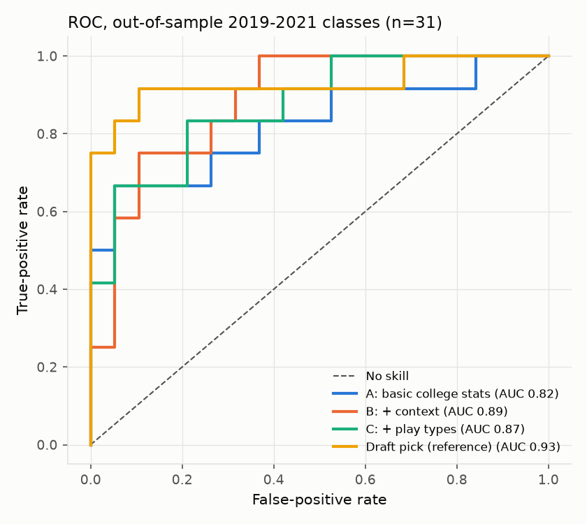
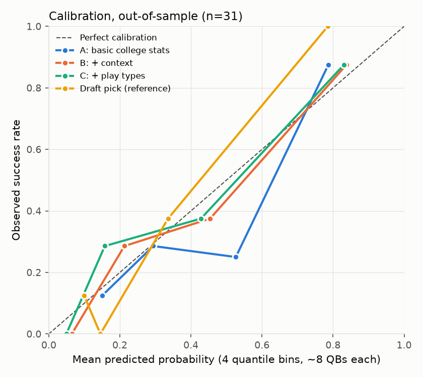
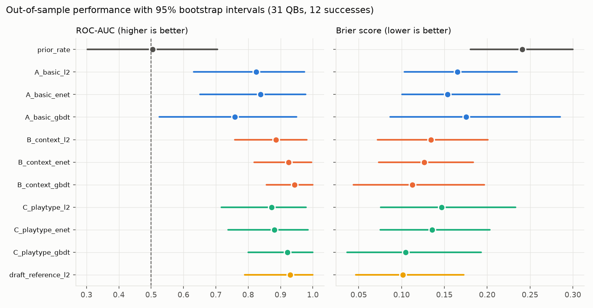
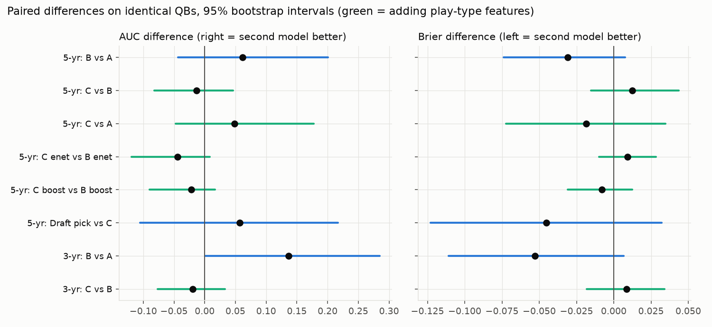
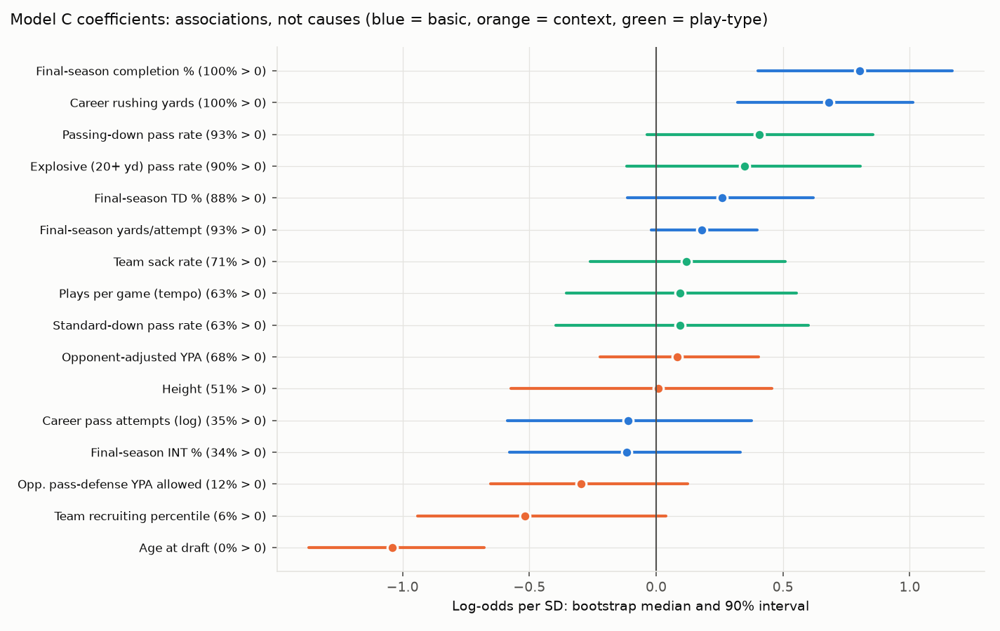
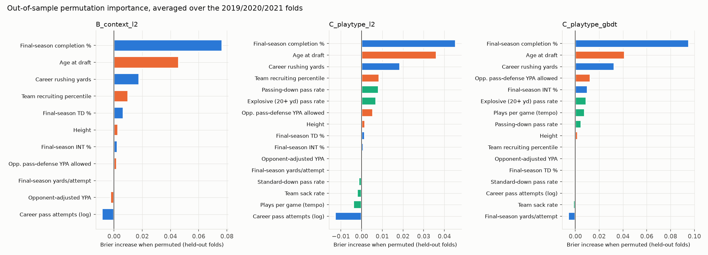
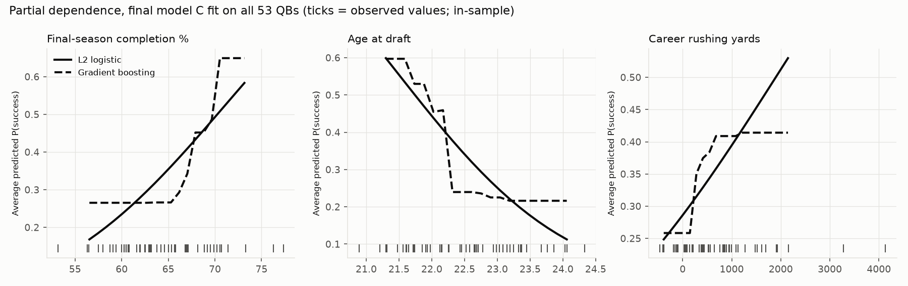
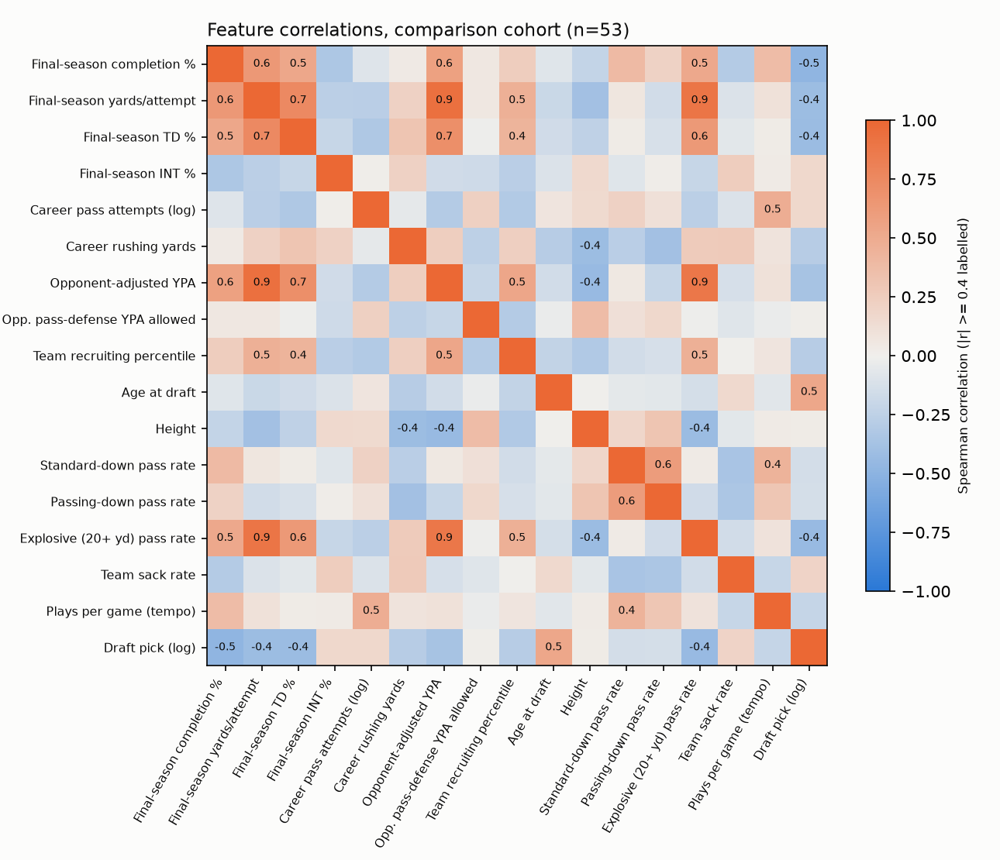

# NFL QB career-success model: evaluation

Generated by `python -m src.modeling.evaluate` from out-of-sample predictions written by `train.py` (model version 1.0.0, seed 20261110, dataset 1.0.0). Every number below is out-of-sample: each QB is scored by a model trained only on earlier draft classes.

## Bottom line

* **Target:** 32+ regular-season NFL starts in the first five seasons. **Sample:** 53 drafted QBs from the 2017-2021 classes (19 successes). Of those, 31 QBs from the 2019-2021 classes (12 successes) are scored out-of-sample.
* **College statistics carry real signal.** Basic stats reach AUC 0.825 [0.632, 0.974], against 0.5 for no skill. Adding opponent/team context gives AUC 0.886 [0.759, 0.982] and Brier 0.134, versus 0.241 for the base-rate baseline. The A-to-B gain (AUC +0.061, 95% CI [-0.043, +0.201]) points in the right direction but is not statistically clear with 31 QBs.
* **Play-type features did not improve the primary model.** B to C with L2 logistic changes AUC by -0.013 [-0.082, +0.046] and Brier by +0.012 [-0.015, +0.044] (positive Brier = worse). Elastic net agrees (AUC -0.044). With gradient boosting, play types improved Brier (-0.008 [-0.031, +0.012]) but lowered AUC (-0.022). On the larger 3-season task the change is AUC -0.020 [-0.077, +0.033]. **Verdict: no detectable improvement.** Every interval includes zero, and the AUC point estimate is slightly negative in all three model families and on the 3-season task. There is no sign of a benefit, but with this sample a small one cannot be ruled out.
* **Draft position (reference only, not a college model)** scores AUC 0.930 [0.789, 1.000] and Brier 0.101. NFL teams' own evaluation (and the playing time a high pick is given) already encodes more than these college features do. Part of this is self-fulfilling: early picks are handed starts.
* **No model is production-ready.** With 31 holdout QBs, AUC intervals span roughly +/-0.1 to +/-0.17. Treat these numbers as an early estimate, not a validated accuracy figure. Boosting with context features (`B_context_gbdt`) has the highest AUC in the table, but picking the best of 11 models on the same 31 QBs would overfit the holdout. The pre-specified primary comparison is the L2 logistic series.

## Design

* **Rows:** the same-QB comparison cohort from `reports/model_training_readiness.md`. Every model in every table is fit and scored on exactly these QBs.
* **Validation:** rolling-origin by draft class. 2019 is predicted from 2017-2018 (22 training QBs), 2020 from 2017-2019 (32), and 2021 from 2017-2020 (44). There is no random splitting.
* **Leakage control:** preprocessing (median imputation, standardisation) sits inside sklearn Pipelines, so it is re-fit on each fold's training classes only. Features are pre-draft only. Draft slot appears only in the reference model. Tests check that training classes are always earlier than the test class.
* **Hyperparameters were pre-specified, not tuned:** L2 C=0.5; elastic net C=0.5, l1_ratio=0.5; gradient boosting with 100 trees, depth 2, learning rate 0.05, subsample 0.8 and min leaf 4. A C-sensitivity grid is shown below and was not used for selection.
* **Decision threshold:** each fold's training success rate (0.31-0.34), not 0.5. Successes are a third of the sample, and a 0.5 cut-off would trade recall away arbitrarily.
* **XGBoost was not run.** It is not installed and is not statistically justified with about 19 positive events. sklearn gradient boosting stands in as an exploratory tree model. No neural networks.

## Primary results (out-of-sample, 2019-2021 classes)

| Model | Features | ROC-AUC [95% CI] | Brier [95% CI] | Log loss | Brier skill vs base rate | Precision | Recall | TP/FP/TN/FN |
|---|---|---|---|---|---|---|---|---|
| `prior_rate` | 0 | n/a (constant within fold) | 0.241 [0.180, 0.300] | 0.676 | +0.00 | 0.387 | 1.000 | 12/19/0/0 |
| `A_basic_l2` | 6 | 0.825 [0.632, 0.974] | 0.165 [0.103, 0.235] | 0.506 | +0.31 | 0.588 | 0.833 | 10/7/12/2 |
| `B_context_l2` | 11 | 0.886 [0.759, 0.982] | 0.134 [0.072, 0.201] | 0.408 | +0.44 | 0.625 | 0.833 | 10/6/13/2 |
| `C_playtype_l2` | 16 | 0.873 [0.717, 0.979] | 0.147 [0.076, 0.233] | 0.441 | +0.39 | 0.714 | 0.833 | 10/4/15/2 |
| `A_basic_enet` | 6 | 0.838 [0.651, 0.977] | 0.154 [0.101, 0.215] | 0.481 | +0.36 | 0.526 | 0.833 | 10/9/10/2 |
| `B_context_enet` | 11 | 0.925 [0.818, 0.996] | 0.126 [0.074, 0.184] | 0.395 | +0.48 | 0.688 | 0.917 | 11/5/14/1 |
| `C_playtype_enet` | 16 | 0.882 [0.737, 0.985] | 0.136 [0.075, 0.203] | 0.420 | +0.44 | 0.692 | 0.750 | 9/4/15/3 |
| `A_basic_gbdt` | 6 | 0.759 [0.525, 0.950] | 0.175 [0.087, 0.285] | 0.581 | +0.27 | 0.571 | 0.667 | 8/6/13/4 |
| `B_context_gbdt` | 11 | 0.943 [0.857, 1.000] | 0.113 [0.044, 0.197] | 0.341 | +0.53 | 0.833 | 0.833 | 10/2/17/2 |
| `C_playtype_gbdt` | 16 | 0.921 [0.800, 1.000] | 0.105 [0.037, 0.193] | 0.345 | +0.57 | 0.909 | 0.833 | 10/1/18/2 |
| `draft_reference_l2` | 1 | 0.930 [0.789, 1.000] | 0.101 [0.047, 0.173] | 0.350 | +0.58 | 0.909 | 0.833 | 10/1/18/2 |

Precision and recall use the documented threshold (training success rate). Accuracy is deliberately not headlined: with a 39% success rate in the holdout, always predicting "no" scores 61%. The base-rate model's pooled AUC is not meaningful, because its prediction is constant within each fold.







### By test class

| Model | 2019 AUC / Brier | 2020 AUC / Brier | 2021 AUC / Brier (latest holdout) |
|---|---|---|---|
| `A_basic_l2` | 0.857 / 0.177 (n=10, 3+) | 0.829 / 0.151 (n=12, 5+) | 1.000 / 0.171 (n=9, 4+) |
| `B_context_l2` | 0.905 / 0.158 (n=10, 3+) | 0.914 / 0.129 (n=12, 5+) | 1.000 / 0.114 (n=9, 4+) |
| `C_playtype_l2` | 0.810 / 0.199 (n=10, 3+) | 0.943 / 0.129 (n=12, 5+) | 1.000 / 0.111 (n=9, 4+) |
| `C_playtype_gbdt` | 0.810 / 0.164 (n=10, 3+) | 0.971 / 0.116 (n=12, 5+) | 1.000 / 0.024 (n=9, 4+) |
| `draft_reference_l2` | 0.714 / 0.133 (n=10, 3+) | 1.000 / 0.106 (n=12, 5+) | 1.000 / 0.060 (n=9, 4+) |

Single-class results rest on 9-12 QBs each. The 2021 column is the "latest fully observed class" holdout, shown for completeness. It is far too small to judge a model on its own.

### Calibration

Calibration is estimated with 4 quantile bins of about 8 QBs (expected calibration error, 4 bins: A_basic_l2 0.103, B_context_l2 0.063, C_playtype_l2 0.067, draft_reference_l2 0.105). The bins are too coarse to diagnose miscalibration reliably. The Brier score, which combines calibration and discrimination, is the better summary at this size.

## Do detailed play types improve predictions?

Paired comparison on identical QBs and folds, with bootstrap resampling of QBs. AUC: a positive difference means the second model is better. Brier and log loss: a negative difference means the second model is better.

| Task | Comparison | AUC diff [95% CI] | P(boot: better AUC) | Brier diff [95% CI] | P(boot: better Brier) | Log-loss diff |
|---|---|---|---|---|---|---|
| 5-yr, 32 starts | `B_context_l2` vs `A_basic_l2` | +0.061 [-0.043, +0.201] | 83% | -0.031 [-0.074, +0.008] | 94% | -0.097 |
| 5-yr, 32 starts | `C_playtype_l2` vs `B_context_l2` | -0.013 [-0.082, +0.046] | 31% | +0.012 [-0.015, +0.044] | 21% | +0.033 |
| 5-yr, 32 starts | `C_playtype_l2` vs `A_basic_l2` | +0.048 [-0.048, +0.177] | 75% | -0.019 [-0.072, +0.035] | 75% | -0.064 |
| 5-yr, 32 starts | `C_playtype_enet` vs `B_context_enet` | -0.044 [-0.119, +0.008] | 4% | +0.009 [-0.010, +0.028] | 17% | +0.025 |
| 5-yr, 32 starts | `C_playtype_gbdt` vs `B_context_gbdt` | -0.022 [-0.090, +0.017] | 13% | -0.008 [-0.031, +0.012] | 76% | +0.003 |
| 5-yr, 32 starts | `draft_reference_l2` vs `C_playtype_l2` | +0.057 [-0.105, +0.217] | 74% | -0.045 [-0.123, +0.032] | 88% | -0.091 |
| 3-yr, 16 starts | `B_context_l2` vs `A_basic_l2` | +0.136 [+0.001, +0.285] | 98% | -0.053 [-0.111, +0.007] | 96% | -0.085 |
| 3-yr, 16 starts | `C_playtype_l2` vs `B_context_l2` | -0.020 [-0.077, +0.033] | 23% | +0.009 [-0.018, +0.034] | 26% | +0.014 |



Reading: the context features (B) are the most consistent addition. The five play-type features (C) add nothing detectable on top of B. The only comparison whose interval clears zero is B over A on the 3-season task, and only just, with 8 comparisons run. The linear models get slightly worse with play types, which is what five extra noisy features cost when there are 22-44 training QBs. Gradient boosting improves its Brier but loses AUC. Two caveats limit how far "no improvement" can be pushed. (1) The play-type profile describes the QB's team offense, not the QB himself: the slim play cache has no passer id, and CFBD play types do not identify RPO, play-action or formations. (2) With 31 holdout QBs, a true AUC gain under about 0.10 is undetectable.

## Supplementary analyses

### Shorter horizon: 16+ starts in the first 3 seasons (2017-2023 classes)

More classes have complete 3-season windows, so this adds the 2022-2023 classes: 53 out-of-sample QBs (20 successes), rolling over the 2019-2023 test classes.

| Model | ROC-AUC [95% CI] | Brier [95% CI] | Brier skill |
|---|---|---|---|
| `prior_rate` | n/a | 0.239 [0.217, 0.263] | +0.00 |
| `A_basic_l2` | 0.620 [0.450, 0.776] | 0.251 [0.200, 0.302] | -0.05 |
| `B_context_l2` | 0.756 [0.604, 0.882] | 0.198 [0.135, 0.269] | +0.17 |
| `C_playtype_l2` | 0.736 [0.573, 0.870] | 0.206 [0.140, 0.280] | +0.14 |
| `draft_reference_l2` | 0.811 [0.664, 0.932] | 0.153 [0.098, 0.217] | +0.36 |

Same pattern: context helps, play types add nothing detectable, and draft position is strongest. Signal is weaker at the shorter horizon, since many good QBs sit behind a veteran for 1-2 years.

### Adding the 2005-2016 classes to training (A/B feature sets only)

Older classes have no play-by-play, so this check covers only models without play types. Their 137 QBs (34 successes) are added to every fold's training set, and the model is scored on the same 31 holdout QBs.

| Model | AUC, cohort-only training | AUC, + 2005-2016 | Brier, cohort-only | Brier, + 2005-2016 |
|---|---|---|---|---|
| `A_basic_l2` | 0.825 | 0.746 | 0.165 | 0.192 |
| `B_context_l2` | 0.886 | 0.868 | 0.134 | 0.152 |
| `draft_reference_l2` | 0.930 | 0.930 | 0.101 | 0.096 |

Adding 137 older QBs did **not** improve the college-stat models on recent classes: AUC and Brier both got worse for A, and slightly worse for B. This suggests era drift: college passing numbers inflated sharply after 2010, so the same completion % or YPA means something different. Era-normalising college stats (for example, z-scores within season) is the next thing to try before pooling eras. Draft position is stable across eras.

### Regularisation sensitivity (not used for model selection)

| C | A AUC | B AUC | C AUC | A Brier | B Brier | C Brier |
|---|---|---|---|---|---|---|
| 0.05 | 0.829 | 0.860 | 0.855 | 0.182 | 0.163 | 0.160 |
| 0.1 | 0.829 | 0.882 | 0.860 | 0.169 | 0.146 | 0.146 |
| 0.3 | 0.820 | 0.890 | 0.868 | 0.163 | 0.134 | 0.140 |
| 0.5 | 0.825 | 0.886 | 0.873 | 0.165 | 0.134 | 0.147 |
| 1.0 | 0.820 | 0.877 | 0.855 | 0.172 | 0.141 | 0.164 |
| 3.0 | 0.794 | 0.860 | 0.838 | 0.187 | 0.160 | 0.201 |
| 10.0 | 0.789 | 0.846 | 0.820 | 0.204 | 0.201 | 0.233 |

In AUC, B >= C > A at every regularisation strength. In Brier, C only matches or slightly beats B under the strongest regularisation (C <= 0.1), where the play-type coefficients are shrunk toward zero. With weaker regularisation, C falls further behind B. The conclusion, no detectable gain from play types, holds at every C.

## Explainability (associations, not causes)

The final models are re-fit on all 53 cohort QBs for these explanations and for `predict.py`. Coefficients are standardised (log-odds per standard deviation). The bootstrap column shows how often a coefficient stays positive when the 53 QBs are resampled 1,000 times. Values near 50% mean the sign itself is unreliable.

| Feature | Group | Coefficient (final model C) | Bootstrap median [90% interval] | % of resamples > 0 | Out-of-sample permutation importance (Brier) | Mean abs. log-odds contribution |
|---|---|---|---|---|---|---|
| Age at draft | B context | -1.090 | -1.041 [-1.369, -0.678] | 0% | +0.0362 | 0.913 |
| Final-season completion % | A basic | +0.864 | +0.803 [+0.400, +1.167] | 100% | +0.0454 | 0.699 |
| Career rushing yards | A basic | +0.682 | +0.681 [+0.322, +1.014] | 100% | +0.0185 | 0.504 |
| Team recruiting percentile | B context | -0.587 | -0.516 [-0.942, +0.040] | 6% | +0.0085 | 0.476 |
| Passing-down pass rate | C play-type | +0.442 | +0.407 [-0.036, +0.855] | 93% | +0.0082 | 0.354 |
| Explosive (20+ yd) pass rate | C play-type | +0.348 | +0.350 [-0.118, +0.805] | 90% | +0.0070 | 0.267 |
| Opp. pass-defense YPA allowed | B context | -0.334 | -0.296 [-0.653, +0.124] | 12% | +0.0054 | 0.288 |
| Final-season TD % | A basic | +0.269 | +0.261 [-0.113, +0.619] | 88% | +0.0016 | 0.213 |
| Final-season yards/attempt | A basic | +0.130 | +0.179 [-0.019, +0.399] | 93% | -0.0004 | 0.103 |
| Team sack rate | C play-type | +0.129 | +0.118 [-0.259, +0.509] | 71% | -0.0021 | 0.107 |
| Final-season INT % | A basic | -0.153 | -0.117 [-0.579, +0.331] | 34% | +0.0009 | 0.124 |
| Career pass attempts (log) | A basic | -0.102 | -0.111 [-0.587, +0.376] | 35% | -0.0128 | 0.078 |
| Plays per game (tempo) | C play-type | +0.022 | +0.094 [-0.355, +0.552] | 63% | -0.0040 | 0.018 |
| Standard-down pass rate | C play-type | +0.094 | +0.094 [-0.395, +0.601] | 63% | -0.0013 | 0.072 |
| Opponent-adjusted YPA | B context | +0.014 | +0.084 [-0.221, +0.405] | 68% | +0.0003 | 0.012 |
| Height | B context | -0.013 | +0.007 [-0.574, +0.456] | 51% | +0.0016 | 0.011 |







The "mean abs. log-odds contribution" column gives exact SHAP values for the linear model, assuming independent features: coefficient times standardised value. It was computed directly, because the optional `shap` package is not installed and is not needed for a linear model. Permutation importance is measured on the held-out folds, weighted by fold size. Negative values mean that shuffling the feature *improved* held-out Brier, i.e. the feature was adding noise.

**Correlated features** (|Spearman| >= 0.5) split importance between them, so neither member of a pair should be read alone:

* Final-season yards/attempt - Opponent-adjusted YPA: +0.94
* Final-season yards/attempt - Explosive (20+ yd) pass rate: +0.90
* Opponent-adjusted YPA - Explosive (20+ yd) pass rate: +0.88
* Final-season yards/attempt - Final-season TD %: +0.75
* Final-season TD % - Opponent-adjusted YPA: +0.71
* Final-season completion % - Final-season yards/attempt: +0.63
* Final-season TD % - Explosive (20+ yd) pass rate: +0.63
* Standard-down pass rate - Passing-down pass rate: +0.60
* Final-season completion % - Opponent-adjusted YPA: +0.57
* Opponent-adjusted YPA - Team recruiting percentile: +0.54
* Final-season completion % - Final-season TD %: +0.53
* Age at draft - Draft pick (log): +0.52
* Final-season completion % - Explosive (20+ yd) pass rate: +0.52



**What the model leans on.** Signs that hold in at least 90% of bootstrap resamples: younger age at draft (-), higher final-season completion % (+), more career rushing yards (+), and a *less* talented recruiting class around the QB (-, 94%). Two play-type features have positive signs in about 90% of resamples (passing-down pass rate, explosive pass rate), but the explosive-pass rate is 0.90 correlated with yards per attempt, so the two share one signal. Out of sample, the play-type features add nothing (see above).

None of this is causal. The negative age coefficient does not mean that being younger causes success. Age at draft reflects early-entry decisions, which follow perceived talent, and it is 0.52 correlated with draft slot. The negative recruiting coefficient is consistent with "produced without elite teammates", but it also mixes in the QB's own recruitment and selection into the draft. Starts also depend on opportunity (draft slot, depth chart and team need), not only ability.

## Limitations

1. **Small sample.** There are 53 QBs and 19 successes in total, and 31 holdout QBs. Intervals are wide and differences under about 0.10 AUC cannot be detected. No result here is a validated accuracy figure.
2. **Starts measure opportunity as well as ability.** High picks get starts that low picks would not. That is also why draft position predicts so well, partly by construction.
3. **Threshold sensitivity.** Three QBs sit within 3 starts of 32: Love (33), Wilson (33) and Mills (30). Single games decide their labels.
4. **The play-type profile is team-level.** It has no passer id, no RPO/play-action/formation data, and FCS QBs have none (4 eligible QBs excluded, all non-successes).
5. **Era drift.** Pooling the 2005-2016 classes hurt. College statistics are not comparable across eras without normalisation.
6. **No verified college starts, injury history or pro-day data** in any ingested source.
7. **Hyperparameters were fixed a priori.** Results could shift modestly with other reasonable choices; the sensitivity grid suggests the ordering is stable.

## Saved artifacts

* Models: `models/qb_career_success/v1.0.0/*.joblib`. Each is a dict with the fitted sklearn Pipeline (imputer, scaler, model), the feature list and the threshold.
* `metadata.json` records the training cutoff, dataset hashes, feature schema, all model parameters, the random seed and package versions.
* Out-of-sample predictions: `results/modeling/oof_predictions.csv`. Metrics: `results/modeling/metrics.csv`, `paired_differences.csv` and `per_fold_metrics.csv`.

## Reproduce

```bash
python -m src.modeling.build_dataset   # dataset, targets, readiness report
python -m src.modeling.train           # rolling-origin validation + final models
python -m src.modeling.evaluate        # metrics, figures, this report
python -m src.modeling.predict         # score the censored 2022-2026 classes (not evaluable yet)
python -m pytest -q
```
