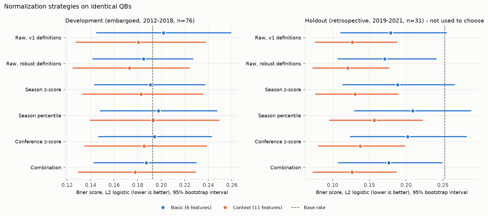

# Normalization ablation

Generated by `python -m src.modeling.evaluate_v2`. Six feature strategies are compared, each at two levels (basic: 6 features; context: 11), across three model families. All 36 configurations run on identical QBs and identical folds. **Selection used only the development folds** (embargoed, test classes 2012-2018, 76 QBs). The holdout columns are shown for transparency and played no part in the choice.

## Strategies

| Strategy | Definition |
|---|---|
| `raw_v1` | v1 features exactly. Career pass attempts and career rushing yards are truncated for the 2005-2008 classes (no CFBD data before 2004). |
| `raw` | Truncation-robust definitions, raw units: final-season rates and attempts per game, plus rushing yards per game over the last 3 seasons. |
| `season_z` | The `raw` features as z-scores against the season's FBS reference passers (100+ attempts). |
| `season_pct` | The `raw` features as season percentiles. |
| `conf_z` | The `raw` features as conference-season z-scores, with a season fallback for groups under 6 passers. |
| `combo` | Season z-scores for the features whose reference population shifted at least 0.3 SD (completion %, YPA, INT %, opponent-adjusted YPA), raw for the rest. Chosen from the era analysis before modeling. |

Context adds three era-stable features to every strategy: team recruiting percentile, age at draft and height.

## Development results (used for selection)

Selection rule: lowest pooled development Brier. Anything within 0.002 of the best counts as tied, and ties go to the simplest configuration (raw before normalized, basic before context, L2 before elastic net before boosting). **Selected: `raw|context|l2`.**

| Configuration | Dev Brier | Dev log loss | Tied with best | Holdout Brier (retro) | Holdout AUC (retro) |
|---|---|---|---|---|---|
| `raw|context|enet` | 0.1729 | 0.5251 | yes | 0.125 | 0.921 |
| `raw|context|l2` (selected) | 0.1731 | 0.5304 | yes | 0.121 | 0.921 |
| `combo|context|enet` | 0.1756 | 0.5314 |  | 0.129 | 0.925 |
| `combo|context|l2` | 0.1778 | 0.5414 |  | 0.126 | 0.921 |
| `conf_z|context|enet` | 0.1779 | 0.5361 |  | 0.138 | 0.934 |
| `season_z|context|enet` | 0.1795 | 0.5424 |  | 0.134 | 0.925 |
| `raw_v1|context|enet` | 0.1799 | 0.5616 |  | 0.129 | 0.917 |
| `raw_v1|context|l2` | 0.1806 | 0.5724 |  | 0.127 | 0.912 |
| `season_z|context|l2` | 0.1829 | 0.5581 |  | 0.130 | 0.930 |
| `raw|basic|l2` | 0.1850 | 0.5515 |  | 0.171 | 0.851 |
| `conf_z|context|l2` | 0.1853 | 0.5547 |  | 0.138 | 0.925 |
| `season_pct|context|enet` | 0.1860 | 0.5571 |  | 0.157 | 0.899 |
| `combo|basic|l2` | 0.1872 | 0.5567 |  | 0.176 | 0.860 |
| `raw|basic|enet` | 0.1888 | 0.5628 |  | 0.175 | 0.855 |
| `combo|basic|enet` | 0.1892 | 0.5637 |  | 0.180 | 0.851 |
| `conf_z|basic|enet` | 0.1902 | 0.5676 |  | 0.205 | 0.829 |
| `season_z|basic|l2` | 0.1907 | 0.5657 |  | 0.189 | 0.864 |
| `season_z|basic|enet` | 0.1908 | 0.5682 |  | 0.193 | 0.855 |
| `season_pct|context|l2` | 0.1931 | 0.5827 |  | 0.157 | 0.886 |
| `conf_z|basic|l2` | 0.1943 | 0.5764 |  | 0.202 | 0.825 |
| `season_pct|basic|enet` | 0.1974 | 0.5819 |  | 0.211 | 0.798 |
| `conf_z|context|gbdt` | 0.1974 | 0.6099 |  | 0.130 | 0.912 |
| `season_pct|basic|l2` | 0.1976 | 0.5815 |  | 0.209 | 0.794 |
| `raw_v1|basic|enet` | 0.2011 | 0.6025 |  | 0.182 | 0.789 |
| `raw_v1|basic|l2` | 0.2019 | 0.6037 |  | 0.179 | 0.794 |
| `raw|context|gbdt` | 0.2127 | 0.6536 |  | 0.098 | 0.952 |
| `raw_v1|context|gbdt` | 0.2136 | 0.7113 |  | 0.129 | 0.890 |
| `conf_z|basic|gbdt` | 0.2157 | 0.6502 |  | 0.162 | 0.912 |
| `season_pct|context|gbdt` | 0.2195 | 0.6790 |  | 0.134 | 0.925 |
| `combo|context|gbdt` | 0.2224 | 0.6815 |  | 0.091 | 0.969 |
| `season_pct|basic|gbdt` | 0.2283 | 0.6920 |  | 0.197 | 0.811 |
| `season_z|context|gbdt` | 0.2295 | 0.7121 |  | 0.105 | 0.969 |
| `combo|basic|gbdt` | 0.2339 | 0.7170 |  | 0.144 | 0.851 |
| `season_z|basic|gbdt` | 0.2368 | 0.7349 |  | 0.164 | 0.851 |
| `raw|basic|gbdt` | 0.2388 | 0.7162 |  | 0.143 | 0.860 |
| `raw_v1|basic|gbdt` | 0.2431 | 0.7827 |  | 0.168 | 0.785 |

Development base-rate Brier: 0.1927. Holdout base-rate Brier (retrospective): 0.253.

## Paired comparisons against `raw` (L2 logistic, identical QBs)

| Set | Level | Comparison | Brier diff [95% CI] | P(boot: normalized better) | AUC diff [95% CI] |
|---|---|---|---|---|---|
| development | context | season_z vs raw | +0.010 [+0.005, +0.015] | 0% | -0.032 [-0.059, -0.010] |
| development | context | season_pct vs raw | +0.020 [+0.006, +0.036] | 0% | -0.057 [-0.111, -0.009] |
| development | context | conf_z vs raw | +0.012 [-0.008, +0.031] | 10% | -0.034 [-0.093, +0.031] |
| development | context | combo vs raw | +0.005 [+0.002, +0.008] | 0% | -0.012 [-0.027, +0.000] |
| development | context | raw (robust) vs raw_v1 | -0.008 [-0.022, +0.004] | 87% | +0.064 [+0.010, +0.129] |
| development | basic | season_z vs raw | +0.006 [-0.001, +0.013] | 6% | -0.045 [-0.099, +0.006] |
| development | basic | season_pct vs raw | +0.013 [-0.003, +0.030] | 7% | -0.063 [-0.173, +0.045] |
| development | basic | conf_z vs raw | +0.009 [-0.004, +0.023] | 9% | -0.075 [-0.182, +0.023] |
| development | basic | combo vs raw | +0.002 [-0.002, +0.006] | 14% | -0.010 [-0.053, +0.033] |
| development | basic | raw (robust) vs raw_v1 | -0.017 [-0.040, +0.003] | 95% | +0.093 [-0.021, +0.220] |
| holdout | context | season_z vs raw | +0.010 [-0.006, +0.025] | 12% | +0.009 [-0.018, +0.050] |
| holdout | context | season_pct vs raw | +0.036 [-0.000, +0.077] | 3% | -0.035 [-0.142, +0.046] |
| holdout | context | conf_z vs raw | +0.017 [-0.013, +0.054] | 16% | +0.004 [-0.053, +0.065] |
| holdout | context | combo vs raw | +0.006 [-0.003, +0.014] | 10% | +0.000 [+0.000, +0.000] |
| holdout | context | raw (robust) vs raw_v1 | -0.006 [-0.015, +0.002] | 92% | +0.009 [-0.018, +0.054] |
| holdout | basic | season_z vs raw | +0.018 [-0.001, +0.036] | 3% | +0.013 [-0.022, +0.057] |
| holdout | basic | season_pct vs raw | +0.038 [+0.004, +0.075] | 2% | -0.057 [-0.190, +0.051] |
| holdout | basic | conf_z vs raw | +0.031 [+0.004, +0.060] | 1% | -0.026 [-0.097, +0.031] |
| holdout | basic | combo vs raw | +0.005 [-0.001, +0.011] | 4% | +0.009 [-0.018, +0.046] |
| holdout | basic | raw (robust) vs raw_v1 | -0.008 [-0.024, +0.006] | 84% | +0.057 [-0.009, +0.155] |

## Interpretation

* **Normalization did not improve prediction.** At the context level, season z-scores against raw change development Brier by +0.010 [+0.005, +0.015], and no normalized strategy beats raw in any development or holdout comparison. Several development intervals exclude zero in the *wrong* direction (season z, season percentile and combo at the context level): normalizing made predictions slightly worse.
* **Two readings of "worse", which the data cannot separate.** (1) Part of the era drift is genuine: QBs became more accurate, and absolute accuracy still matters in the NFL, so removing the level removes signal. (2) A z-score against roughly 150 passers per season adds a little noise of its own. Either way, the season level should not simply be subtracted out. The bootstrap resamples QBs, not classes, so these intervals are somewhat optimistic.
* **The robust redefinitions mattered more.** Replacing truncated career totals with final-season and recent-season measures (`raw` against `raw_v1`, basic level) changes development Brier by -0.017 [-0.040, +0.003]. It is the only change in the ablation that improves predictions, though its interval includes zero.
* **Why normalization adds little.** The era analysis (`college_era_analysis.md`) found that season explains at most about 5% of the variance in any college passing statistic. Drift is at most 0.55 SD (completion %, INT %) over twenty years, against between-QB spreads of a full SD. A logistic model with context features also already carries era-stable signals (age, recruiting percentile). Removing a small level shift therefore changes rankings very little. Percentiles and conference z-scores also discard information: percentiles flatten the tails, and conference groups of 6-14 passers produce noisy baselines.
* **This does not mean era effects are zero.** It means they are too small, relative to between-QB differences, to change predictions measurably with 183 QBs. A larger sample, or a model that interacts era with other features, could still find value.

## Normalization details

* **Reference population:** every FBS passer-season with at least 100 attempts and at least 4 games with a pass attempt, from all college passers (not only drafted QBs).
* **Formulas:** z = (x - mean) / SD, clipped to +/-4. Percentile = mid-rank empirical CDF. INT % and schedule strength are flipped so that higher is better.
* **Edge cases:** fewer than 50 attempts gives NaN; zero variance or a group of fewer than 2 gives NaN; conference groups under 6 fall back to the season baseline.
* **Leakage:** a season-s baseline uses only season-s passers, which is known before the next draft. The baselines use no NFL outcome. Learned preprocessing (imputation, scaling) is fit inside each training fold.
* Code: `src/modeling/era.py`. Tests: `tests/test_era_normalization.py`.
