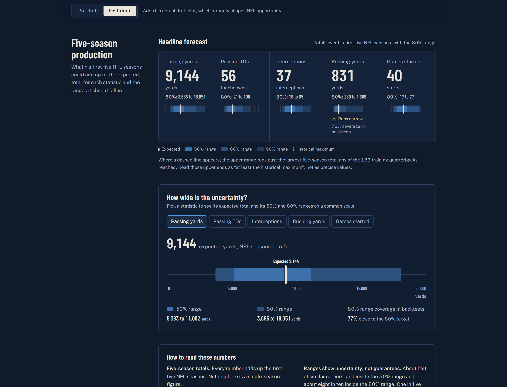

# Phase 6B: interactive scouting dashboard

A working Next.js frontend (`frontend/` at the repository root) on top of the Phase-6A FastAPI backend. Every number it
shows comes from the API: the frontend contains no prediction logic, no model files and no credentials. Nothing was
deployed, committed or pushed, and no model or artifact was changed.

Companion documents: [`frontend_integration_tests.md`](frontend_integration_tests.md),
[`frontend_deployment_checklist.md`](frontend_deployment_checklist.md) and [`../../frontend/README.md`](../../frontend/README.md).



## 1. Pages

| Route | Content |
|---|---|
| `/` | Headline, autocomplete search, a live pre-draft forecast for the newest class's first pick (Fernando Mendoza, 2026), the full 2026 QB class from the API, what a report covers, links to backtests, methodology and GitHub, data sources |
| `/prospects` | Name search, draft-class filter, drafted-only filter, pagination, URL-backed state, loading/empty/error states, shared-name flags, data availability per result |
| `/prospects/[id]` | Flagship report: header with final-season statistics and data coverage; explicit pre/post-draft switch (in the URL, never changed silently); draft projection; starting chances; five-season production; comparisons; uncertainty; college seasons |
| `/backtesting` | Quarterback selector plus nine curated examples (stars and misses). Each shows a classification banner, cutoff and training classes, grouped bar charts, rulers with the actual result, an error table and starting chances, plus aggregate accuracy over all 107 backtested QBs |
| `/methodology` | Data and cohorts, chronological testing (embargo timeline), draft probability and the Combine finding, round and pick, starting chances and why the draft slot matters, production errors before and after the draft, calibration, comparisons, limitations, each with its evaluation status |

The report sections in detail:

* **Draft projection.** P(drafted) before and after the Combine where supported; round groups, with single rounds behind a
  disclosure; a pick range on the field ruler. In post-draft mode the ruler also shows the actual pick.
* **Starting chances.** P(16+/32+/64+ starts) as nested bars with the five-season window.
* **Five-season production.** Passing yards, TDs and INTs as the hero statistics, then the other seven, with 50/80/90%
  rulers, a full table with measured coverage, and a season-by-season chart.
* **Comparisons.** Five comps with similarities, differences, observed outcomes, profile distance (labelled not a
  probability), side-by-side final-season statistics and links to each comp's report.
* **Uncertainty.** Warnings, measured interval coverage, data limitations and model versions.

Pre/post-draft separation follows the API:

* The pre-draft view hides the actual pick, and shows it only if the reader asks.
* Post-draft is available only with a real pick. For other players the page explains why and offers a clearly labelled
  hypothetical pick.

## 2. Components

* **Field ruler.** Nested interval bands, expected tick, actual flag and reference line, with a full accessible label.
* **Search combobox.** Follows the ARIA combobox pattern, is debounced, never queries for fewer than two characters, and
  flags shared names.
* **Status components.**
  * `Unavailable`: dashed panel with the backend's reason.
  * `WarningList`: icon plus a title per warning code.
  * `ErrorState`: per-error-code text, hint and retry for transient errors.
  * `SlowLoading`: skeletons plus a cold-start note, no fake progress.
* **ChartFrame.** Caption, screen-reader description and a "Show data" table.
* **Shared controls and page sections.** Probability bars, mode switch, hypothetical-pick form, backtest classification
  banner, aggregate-accuracy panel, methodology charts (AUC with 95% intervals, starting-chance Brier against base rate,
  error reduction before and after the draft, coverage against nominal 80%), and an embargo timeline.

shadcn/ui (base-ui) primitives provide the button, tooltip, skeleton and so on. Lucide supplies the icons and Recharts the
charts.

## 3. API endpoints integrated

`GET /api/prospects` (search, landing class list), `/api/prospects/{id}`, `/api/prospects/{id}/forecast?mode=`
(including `assumed_pick`), `/api/prospects/{id}/comparisons`, `/api/backtests/{id}` and `/api/models/performance`
(methodology and aggregate accuracy) are used by the UI.

`/api/prospects/resolve` and `/api/health` are wrapped by the typed client: `resolve` surfaces `AMBIGUOUS_PLAYER` with
its candidates, and `health` is used by the end-to-end tests. `/api/models` is typed but not shown.

* **Types.** Generated from the live OpenAPI schema with `openapi-typescript`. The performance sections, which are `dict`
  on the backend, are typed by hand against the real response.
* **Error codes.** Every documented backend code is mapped to readable text.

## 4. Working example prospects (real API data)

| Player | Shows |
|---|---|
| Fernando Mendoza (`qb_319`, 2026, pick 1) | P(drafted) unavailable (2025 season not verifiable yet); training-maximum flags on several upper ranges; pre-draft 64+ calibration warning |
| Josh Allen (`qb_226`, 2018, pick 7) | Pre- vs post-draft difference; actual pick on the ruler; P(drafted) unavailable (no evidence of four college years) |
| Seth Henigan (`cfb_4606194_2024`, undrafted) | No post-draft forecast without a pick; hypothetical-pick flow |
| Josh Rosen (`qb_227`) | Valid out-of-sample backtest with misses |
| Matt Ryan (`qb_107`) | In-sample illustration, warned |
| C.J. Stroud (`qb_281`) | Out-of-sample forecast with the NFL window still open |

## 5. Charts and visualizations

* Field rulers: pick range and every five-season statistic, with actual results on backtests.
* Probability bars: round groups and single rounds, starting chances.
* Season-by-season bars with 80% whiskers.
* Grouped predicted-vs-actual bars with 80% whiskers, in three unit groups (yards; scoring plays; games), so different
  scales are never mixed.
* Aggregate error-reduction bars.
* Methodology charts: AUC with 95% intervals, starting-chance Brier against base rate, error reduction before and after
  the draft, interval coverage against nominal 80%.
* An embargo timeline.

Radar charts were not used: the comparison API returns similarity explanations, not feature vectors on a common scale. A
side-by-side table of final-season statistics shows the comps honestly instead.

## 6. Testing results

| Check | Result |
|---|---|
| TypeScript (strict, `next typegen && tsc --noEmit`) | 0 errors |
| ESLint | 0 errors, 0 warnings |
| Vitest (unit, component, axe structural rules) | 31 passed |
| Playwright end-to-end against the live API and the production build | 25 passed |
| `next build` | succeeded; static shells for `/`, `/prospects`, `/backtesting`, `/methodology`; partial prerender for `/prospects/[id]` |
| Existing Python suite | see `frontend_integration_tests.md` (run after the frontend work) |

Details, including what each test covers and the issues the tests found, are in `frontend_integration_tests.md`.

## 7. Production build

`npm run build` succeeds with Next.js 16.4.6, Turbopack and Cache Components. The end-to-end suite was run against
`npm start` (the production build) on port 3000, using the backend's real CORS allowlist.

## 8. Mobile responsiveness

* Checked by rendering, not assumed. Every page was captured at 1440 px and 390 px and the screenshots were reviewed.
* Playwright asserts zero horizontal overflow on five pages, both at a Pixel 7 viewport and at desktop width.
* Tables scroll inside their own container, and the stat grids collapse to two columns.

## 9. Accessibility checks

* **axe-core in a real browser.** No serious or critical violations on five pages. The first run found two real issues,
  both fixed:
  * chart surfaces were focusable inside `aria-hidden` containers;
  * inline links were distinguished by colour only (now underlined).
* **axe in jsdom.** Structural rules pass on the report sections, backtest view and open search combobox.
* **Keyboard.** A skip link, a keyboard-operable combobox and radio-group mode switches, and visible focus rings.
* **Screen readers.**
  * Every chart has a description and a data table.
  * Rulers spell out their numbers.
  * Status is never conveyed by colour alone: icons and text label warnings, classifications and inside/outside markers.
* **Contrast and motion.** Data colours were validated for colour-vision deficiency and contrast against the dark
  surface, and `prefers-reduced-motion` is respected.
* **Limit.** No manual screen-reader session (NVDA or VoiceOver) was run.

## 10. Remaining deployment blockers

1. **Data licensing (unchanged from Phase 6A).** CFBD and nflverse terms for public display have not been reviewed. The
   README screenshots also show real players' model output and college statistics. Decide before committing them to a
   public repository.
2. **The backend must be hosted first.** It needs Python 3.14 with the pinned versions and the serving bundle (see
   `deployment_readiness.md`); its Docker image is still unbuilt.
3. **Configuration.** Set `NEXT_PUBLIC_API_BASE_URL` on Vercel and the Vercel origin in the backend's `FRONTEND_ORIGINS`.
4. **Rate limiting.** The backend's limiter is per process; add platform rate limiting.

## 11. Local startup

```bash
# terminal 1 (backend), from nfl-qb-analytics/
uvicorn api.main:app --reload --port 8000

# terminal 2 (frontend), from frontend/
cp .env.example .env.local
npm install
npm run dev            # http://localhost:3000

# checks, from frontend/
npm run lint && npm run typecheck && npm test
npm run build && npm start      # production build on :3000
E2E_BASE_URL=http://localhost:3000 npm run test:e2e
```

## 12. Recommended next steps

1. Review data licences, then deploy the backend (container) and the frontend (Vercel), using
   `frontend_deployment_checklist.md`.
2. Pre-render reports for the listed prospects at build time (forecasts are deterministic) to remove the cold start for
   visitors.
3. Add a prospect comparison view (two reports side by side) and shareable images.
4. Score the 2026 class as its seasons are played, and show that prospectively on the backtesting page.
5. Run a manual screen-reader pass and a usability session with someone outside the project.


## Phase 7 update (2026-11-11): QB Forecast Lab

**Brand.** Renamed QB Forecast Lab, with an SVG favicon, an original Open Graph image, site-wide metadata and a mobile menu.

**Photography.** Six images from Wikimedia Commons (four CC BY, two public domain), each credited on the image and on
`/credits` (inventory: `frontend/ASSET_LICENSES.md`). No player photos: reports use initials and typography.

**Homepage.** A cinematic hero ("From college production to NFL projection."), search, "Explore prospects" and "See
historical accuracy", and a live forecast card. Below it, seven varied sections:
* how the engine works;
* the 2026 class;
* five-season projections, with a real screenshot;
* live comparisons;
* a live predicted-vs-actual backtest;
* evaluation from the API;
* code and methodology links.

**Reports.**
* Photo header with an initials monogram.
* Model versions shown at the top of the forecast.
* Six headline rulers: passing yards, TDs, INTs, rushing yards, rushing TDs, games started.
* A final-season profile dot-strip chart against the five comparisons.

**Backtesting.** Photo header and a "How a fair backtest works" section with the embargo timeline.

**Methodology.** Photo header, motivation, an original pipeline diagram, key findings, bias and missing data, and how to
read uncertainty (including what a confidence interval through zero means).

**New pages.** `/case-study` (portfolio case study with live results and real screenshots) and `/credits`.

**Production hardening.** Security headers and CSP, AVIF/WebP images, `poweredByHeader` off, and `render.yaml` as a backend
hosting example.

**Tests.**

| Check | Result |
|---|---|
| Lint and typecheck | clean |
| Vitest | 35 passed |
| Playwright against the live API | 38 passed, 1 skipped by design (mobile-menu test on desktop) |
| Production build | passes, 10 routes |

See `frontend_visual_qa.md`, `public_data_licensing_review.md` and `portfolio_case_study.md`.


## Phase 8 update (2026-11-11): forecast presentation and brand

* **Forecast section.** A five-statistic headline strip, an interactive 50/80% interval chart, a plain-language "how to
  read these numbers" panel, and the full ten-statistic table, grouped and with toggletip explanations (cards on
  phones). Weak backtest coverage (under 75% for the 80% range) is flagged wherever it appears; post-draft, that is
  rushing yards, rushing TDs and rush attempts. Values are the API's, unchanged.
* **Logo.** A throwing arc that lands on a forecast range, with horizontal lockups, an icon-only mark, favicon, app
  icons, manifest and social image (`frontend/public/brand`, `frontend/src/components/brand.tsx`).
* **Homepage.** The subhead states the product, a live credibility strip (prospect count and backtested careers from the
  API), and a richer featured forecast card.
* **Backend fix.** 429 responses now carry CORS headers (see `frontend_visual_qa.md`).
* Tests: Vitest 45 passed; Playwright 44 passed, 2 skipped by design; Python 305 passed.
