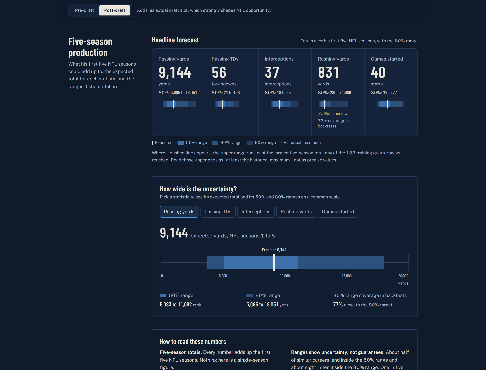

# Portfolio case study: QB Forecast Lab

A version of this case study is also a page on the site (`/case-study`), with live results from the API.



## The problem

Quarterbacks are the most expensive and least predictable picks in the NFL Draft. Public projections are mostly opinions,
with no record of how often they are right. QB Forecast Lab makes forecasts that can be checked: for each college
quarterback, it forecasts how likely he is to be drafted and where, how likely he is to start, and what he will produce in
his first five NFL seasons. Each forecast comes with a measured range of outcomes and a record of how the method did on
real careers.

## The data

* **1,279 prospects:** every drafted quarterback from 2000 to 2026, plus FBS quarterbacks whose final college season is in
  the data.
* **College data** (CollegeFootballData.com): seasons, games, recruiting, team context.
* **NFL data** (nflverse): draft board, season statistics, starts, Combine results.
* **Training cohorts:**
  * career models: 183 drafted quarterbacks (2005 to 2021 classes) with complete five-season windows;
  * draft probability: 556 FBS final seasons with verifiable eligibility (138 drafted);
  * round and pick: 242 drafted quarterbacks.

## Architecture

```text
CFBD API + nflverse ──▶ Python ingestion, identity linking, features ──▶ SQLite / Parquet
                                                                               │
        scikit-learn models (versioned, SHA-256 pinned) ◀── nested chronological backtests
                         │
        serving bundle (4.4 MB, hash-verified) ──▶ FastAPI (Pydantic, error codes, CORS, rate limit)
                                                          │
                                          Next.js 16 + TypeScript site (typed from OpenAPI)
```

## Modelling

* **Draft probability:** L2 logistic regression, before and after the Combine.
* **Round and pick:** draft round as an ordinal or multinomial model chosen by nested validation; pick ranges from ridge
  regression on log pick.
* **Production:** ten five-season totals from quasi-Poisson (pre-draft) and ridge (post-draft) regression, with empirical
  50/80/90% intervals.
* **Starting chances:** 16/32/64+ start probabilities, projected to stay nested.
* **Comparisons:** a nearest-neighbour engine, used for explanation only.
* **Validation:** chronological backtests with a five-season label embargo; model choices made inside earlier classes.

## Results (backtests on classes the models had not seen)

* **Draft probability:** AUC 0.878 from college data and 0.907 with the Combine, against a historical-rate Brier score of
  0.177 (model: 0.115, then 0.091).
* **Draft round:** ranked probability score 0.176 against 0.225 for historical frequencies (three groups).
* **Five-season totals:** errors about 2% smaller than the historical median before the draft, and about 26% smaller after
  it (107 quarterbacks).
* **Interval coverage:** the 80% ranges held the real total 79% (pre-draft) and 77% (post-draft) of the time.

## Findings

1. Most of the Combine's apparent value is the invitation, which is a scouting decision, not the measurements.
2. The draft slot dominates NFL opportunity, so post-draft forecasts are far better than pre-draft ones.
3. Pre-draft production forecasts barely beat history. The 95% intervals include zero for most statistics.
4. NFL efficiency (completion %, YPA) could not be predicted from college data at this sample size.
5. Honest testing changed conclusions. A model-selection rule that looked good failed under nested evaluation and was
   replaced, with the change disclosed.

## Limitations

About ten quarterbacks per class makes every estimate noisy. Undrafted players, coaching, scheme and injuries are not
modelled. Draft eligibility is inferred, not observed. Data licensing for public display has open issues, set out in
`public_data_licensing_review.md`.

## Engineering highlights

* **Tests:** 304 Python tests, plus 35 component tests and 38 end-to-end browser tests (1 skipped) on the frontend.
* **Artifact integrity:** hash-pinned artifacts, and a serving bundle that refuses to serve if it fails verification.
* **Typed API:** OpenAPI-generated types; structured "not available" responses instead of invented numbers.
* **Accessibility:** charts with text descriptions and data tables; axe-clean pages; keyboard and screen-reader support.
* **Licensed imagery** with an inventory (`frontend/ASSET_LICENSES.md`).

## 75-second demo walkthrough

| Time | Show | Say |
|---|---|---|
| 0:00 | Homepage hero | "QB Forecast Lab forecasts how college quarterbacks will do in the NFL, and shows how often those forecasts were right." |
| 0:08 | Type "Allen" in search, pick Josh Allen (Wyoming) | "Every drafted QB since 2000, plus recent college passers. Names aren't unique, so each result shows school and class." |
| 0:15 | Report: pre-draft view, draft section | "Before the draft he's outside the population where I can verify eligibility, so the site says so instead of guessing. Round and pick are still forecast, if drafted." |
| 0:25 | Scroll to starting chances and production | "Starting chances over five seasons, then ten statistics. Each bar is a range, 50, 80 and 90%, measured on later draft classes." |
| 0:35 | Switch to post-draft | "Add his real draft slot, seventh overall, and the forecast moves a lot. The draft slot drives opportunity." |
| 0:42 | Comparisons | "Similar college profiles, with what happened to them. This explains a profile; it doesn't predict a career." |
| 0:50 | Backtesting: Josh Rosen, then Matt Ryan | "Forecasts made only from earlier classes, against real careers. In-sample cases are labelled as such." |
| 1:00 | Accuracy across all backtests | "Across 107 quarterbacks: modest before the draft, much better after it." |
| 1:08 | Methodology: Combine finding | "One finding: most of the Combine's apparent value is just being invited." |
| 1:13 | GitHub link | "Pipeline, models, API and site are all on GitHub, with tests." |

## README blurb for recruiters

> **QB Forecast Lab:** an end-to-end machine-learning product that forecasts college quarterbacks' NFL draft outcomes and
> first-five-season careers. Python data pipeline (CFBD API, nflverse), scikit-learn models evaluated with nested
> chronological backtests and calibrated prediction intervals, a typed FastAPI service, and a Next.js/TypeScript site with
> accessible charts. The project's emphasis is honest evaluation: every forecast is checked against real careers,
> unsupported predictions are withheld, and limitations are stated.
