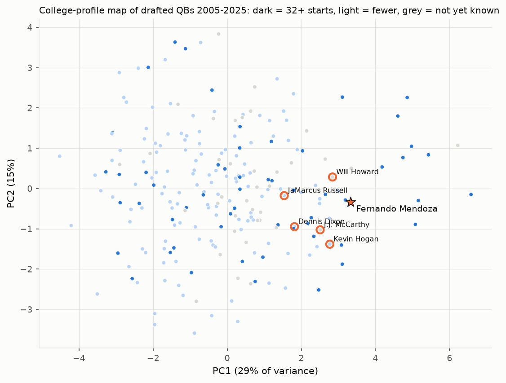

# Historical QB prospect comparisons

Generated by `python -m src.modeling.prospect_similarity`. For a college QB, the engine finds the most similar previously drafted QBs by **college profile only**. NFL outcomes never enter the distance; they are shown afterwards, for context.

## Method

* **Pool:** 237 drafted QBs from 2005-2026 with the v2 college features. A query is compared only with QBs drafted **before** its own class.
* **Profile (14 features):** completion %, yards/attempt, TD %, INT %, attempts/game, rush yds/game, opp.-adjusted YPA, opponent pass-D YPA (low = tough), team pass rate, team recruiting pct., age at draft, height, final-year YPA change, seasons as primary passer.
* **Distance:** Euclidean distance on z-scores. The scaler is fit on the query's pool only. Missing values are skipped and the distance rescaled (nan-Euclidean), so no future-informed imputation is involved. All features have equal weight. This is a modelling choice, not a learned metric.
* **Closeness index (0-100):** the share of all pairwise distances between pool QBs that are larger than this pair's distance. It is a **heuristic ranking aid, not a probability** or a calibrated similarity percentage.
* **Backtests:** comps' outcomes are shown only if they were observable at the query's draft (comp class <= query class - 5). Outcomes not yet known at the time show as blank.

## Do comparable players' outcomes predict NFL success? (exploratory)

Test classes 2012-2021 (107 QBs). Prediction = the share of the 10 nearest comps (from classes with observable outcomes) who reached 32 starts.

| Predictor | ROC-AUC | Brier |
|---|---|---|
| Historical base rate | n/a | 0.211 |
| 10-nearest-comp success rate | 0.691 | 0.189 |
| Same, shrunk toward the base rate (2 pseudo-comps) | 0.703 | 0.191 |

For comparison, the pre-draft logistic model on the same test QBs (`career_production_evaluation.md`) is stronger. Comps are a way to explain a profile, not a better forecaster. Their outcome spread is shown as a descriptive distribution, never as a probability.

The 2-D map is a PCA of the standardised profiles (PC1 29%, PC2 15% of variance), fit on the pool before the highlighted query. Missing values are set to the pool mean for the picture only. Distances in the map are approximate; the table distances use all features.

## Examples

### Fernando Mendoza (Indiana, drafted 2026, round 1, pick 1)

*Current query: comps are from 2005-2025. Outcomes shown where the five-season window is complete; otherwise starts to date.*

| Comp | College | Drafted | Distance | Closeness index (heuristic) | Similar on | Biggest differences (comp vs query) | NFL starts, seasons 1-5 |
|---|---|---|---|---|---|---|---|
| Will Howard | Ohio St. | 2025 R6 #185 | 2.78 | 98 | opp.-adjusted YPA, yards/attempt, opponent pass-D YPA (low = tough) | TD % lower (-1.4 SD); team pass rate higher (+1.1 SD); seasons as primary passer higher (+1.0 SD) | 0 so far (window incomplete) |
| JaMarcus Russell | LSU | 2007 R1 #1 | 3.09 | 95 | seasons as primary passer, height, yards/attempt | opponent pass-D YPA (low = tough) higher (+1.6 SD); TD % lower (-1.4 SD); INT % higher (+0.9 SD) | 25 |
| Kevin Hogan | Stanford | 2016 R5 #162 | 3.11 | 95 | final-year YPA change, yards/attempt, opp.-adjusted YPA | INT % higher (+1.3 SD); opponent pass-D YPA (low = tough) higher (+1.3 SD); height lower (-1.2 SD) | 1 |
| J.J. McCarthy | Michigan | 2024 R1 #10 | 3.11 | 95 | seasons as primary passer, completion %, team pass rate | TD % lower (-2.2 SD); age at draft lower (-1.3 SD); height lower (-1.2 SD) | 10 so far (window incomplete) |
| Dennis Dixon | Oregon | 2008 R5 #156 | 3.15 | 95 | INT %, team recruiting pct., final-year YPA change | TD % lower (-1.6 SD); height lower (-1.2 SD); rush yds/game higher (+1.0 SD) | 3 |

Among the 10 nearest comps with complete outcomes (6): median 38 starts in seasons 1-5 (IQR 8-58); 67% reached 16+, 50% reached 32+, 17% reached 64+. This describes the comps; it is not a probability for the query.

### Ty Simpson (Alabama, drafted 2026, round 1, pick 13)

*Current query: comps are from 2005-2025. Outcomes shown where the five-season window is complete; otherwise starts to date.*

| Comp | College | Drafted | Distance | Closeness index (heuristic) | Similar on | Biggest differences (comp vs query) | NFL starts, seasons 1-5 |
|---|---|---|---|---|---|---|---|
| Davis Mills | Stanford | 2021 R3 #67 | 2.68 | 98 | team pass rate, rush yds/game, opponent pass-D YPA (low = tough) | TD % lower (-1.2 SD); height higher (+1.2 SD); attempts/game higher (+1.1 SD) | 30 |
| Brodie Croyle | Alabama | 2006 R3 #85 | 2.72 | 98 | seasons as primary passer, opp.-adjusted YPA, age at draft | team pass rate lower (-1.4 SD); team recruiting pct. lower (-1.1 SD); completion % lower (-1.0 SD) | 10 |
| Cody Kessler | USC | 2016 R3 #93 | 2.75 | 98 | height, attempts/game, team recruiting pct. | seasons as primary passer higher (+2.1 SD); team pass rate lower (-0.9 SD); rush yds/game lower (-0.8 SD) | 12 |
| David Greene | Georgia | 2005 R3 #85 | 2.89 | 97 | seasons as primary passer, opponent pass-D YPA (low = tough), team recruiting pct. | team pass rate lower (-1.3 SD); completion % lower (-1.2 SD); height higher (+1.2 SD) | 0 |
| Spencer Rattler | South Carolina | 2024 R5 #150 | 2.90 | 97 | team pass rate, rush yds/game, opponent pass-D YPA (low = tough) | seasons as primary passer higher (+2.1 SD); INT % higher (+1.2 SD); completion % higher (+0.9 SD) | 12 so far (window incomplete) |

Among the 10 nearest comps with complete outcomes (9): median 10 starts in seasons 1-5 (IQR 4-30); 33% reached 16+, 22% reached 32+, 0% reached 64+. This describes the comps; it is not a probability for the query.

### Carson Beck (Miami (FL), drafted 2026, round 3, pick 65)

*Current query: comps are from 2005-2025. Outcomes shown where the five-season window is complete; otherwise starts to date.*

| Comp | College | Drafted | Distance | Closeness index (heuristic) | Similar on | Biggest differences (comp vs query) | NFL starts, seasons 1-5 |
|---|---|---|---|---|---|---|---|
| EJ Manuel | Florida St. | 2013 R1 #16 | 2.13 | 100 | height, INT %, opponent pass-D YPA (low = tough) | age at draft lower (-1.3 SD); seasons as primary passer lower (-1.0 SD); completion % lower (-0.9 SD) | 18 |
| Ryan Finley | North Carolina St. | 2019 R4 #104 | 2.47 | 99 | seasons as primary passer, yards/attempt, age at draft | opponent pass-D YPA (low = tough) higher (+1.2 SD); attempts/game higher (+1.2 SD); completion % lower (-1.0 SD) | 4 |
| Kirk Cousins | Michigan St. | 2012 R4 #102 | 2.48 | 99 | seasons as primary passer, attempts/game, opponent pass-D YPA (low = tough) | completion % lower (-1.7 SD); height lower (-1.2 SD); age at draft lower (-0.7 SD) | 41 |
| Joe Milton | Tennessee | 2024 R6 #193 | 2.53 | 99 | height, attempts/game, final-year YPA change | completion % lower (-1.5 SD); INT % lower (-1.5 SD); seasons as primary passer lower (-1.0 SD) | 1 so far (window incomplete) |
| Jake Rudock | Michigan | 2016 R6 #191 | 2.55 | 99 | seasons as primary passer, team recruiting pct., opponent pass-D YPA (low = tough) | completion % lower (-1.7 SD); height lower (-1.2 SD); age at draft lower (-1.1 SD) | 0 |

Among the 10 nearest comps with complete outcomes (7): median 8 starts in seasons 1-5 (IQR 4-18); 43% reached 16+, 14% reached 32+, 0% reached 64+. This describes the comps; it is not a probability for the query.

### Josh Allen (Wyoming, drafted 2018, round 1, pick 7)

*Historical backtest: comps are from classes before 2018. Outcomes are shown only for comps whose five seasons had been played by then.*

| Comp | College | Drafted | Distance | Closeness index (heuristic) | Similar on | Biggest differences (comp vs query) | NFL starts, seasons 1-5 |
|---|---|---|---|---|---|---|---|
| Isaiah Stanback | Washington | 2007 R4 #103 | 2.80 | 98 | seasons as primary passer, rush yds/game, yards/attempt | height lower (-1.8 SD); opp.-adjusted YPA higher (+0.9 SD); age at draft higher (+0.8 SD) | 0 |
| Jacoby Brissett | North Carolina St. | 2016 R3 #91 | 3.13 | 95 | seasons as primary passer, yards/attempt, team pass rate | age at draft higher (+1.5 SD); final-year YPA change higher (+1.2 SD); team recruiting pct. higher (+1.2 SD) | not yet observable |
| Jake Locker | Washington | 2011 R1 #8 | 3.17 | 95 | team pass rate, yards/attempt, completion % | height lower (-1.8 SD); final-year YPA change higher (+1.2 SD); seasons as primary passer higher (+1.0 SD) | 23 |
| Connor Cook | Michigan St. | 2016 R4 #100 | 3.33 | 93 | TD %, completion %, team pass rate | opp.-adjusted YPA higher (+1.5 SD); team recruiting pct. higher (+1.4 SD); age at draft higher (+1.4 SD) | not yet observable |
| Omar Jacobs | Bowling Green | 2006 R5 #164 | 3.40 | 92 | seasons as primary passer, INT %, completion % | attempts/game higher (+1.7 SD); opp.-adjusted YPA higher (+1.6 SD); team recruiting pct. lower (-1.1 SD) | 0 |

Among the 10 nearest comps with complete outcomes (6): median 2 starts in seasons 1-5 (IQR 0-18); 33% reached 16+, 17% reached 32+, 0% reached 64+. This describes the comps; it is not a probability for the query.

### Joe Burrow (LSU, drafted 2020, round 1, pick 1)

*Historical backtest: comps are from classes before 2020. Outcomes are shown only for comps whose five seasons had been played by then.*

| Comp | College | Drafted | Distance | Closeness index (heuristic) | Similar on | Biggest differences (comp vs query) | NFL starts, seasons 1-5 |
|---|---|---|---|---|---|---|---|
| Dwayne Haskins | Ohio St. | 2019 R1 #15 | 3.50 | 90 | seasons as primary passer, height, opponent pass-D YPA (low = tough) | yards/attempt lower (-1.7 SD); opp.-adjusted YPA lower (-1.5 SD); age at draft lower (-1.5 SD) | not yet observable |
| Robert Griffin III | Baylor | 2012 R1 #2 | 3.63 | 88 | yards/attempt, final-year YPA change, opp.-adjusted YPA | team recruiting pct. lower (-1.6 SD); opponent pass-D YPA (low = tough) higher (+1.4 SD); team pass rate lower (-1.4 SD) | 40 |
| Baker Mayfield | Oklahoma | 2018 R1 #1 | 4.10 | 77 | rush yds/game, team recruiting pct., age at draft | seasons as primary passer higher (+2.1 SD); final-year YPA change lower (-2.0 SD); opponent pass-D YPA (low = tough) higher (+1.4 SD) | not yet observable |
| Brandon Doughty | Western Kentucky | 2016 R7 #223 | 4.41 | 68 | height, team pass rate, attempts/game | final-year YPA change lower (-1.9 SD); team recruiting pct. lower (-1.6 SD); opp.-adjusted YPA lower (-1.4 SD) | not yet observable |
| Brandon Allen | Arkansas | 2016 R6 #201 | 4.50 | 65 | opponent pass-D YPA (low = tough), age at draft, team recruiting pct. | completion % lower (-2.2 SD); TD % lower (-1.9 SD); team pass rate lower (-1.4 SD) | not yet observable |

Among the 10 nearest comps with complete outcomes (5): median 61 starts in seasons 1-5 (IQR 40-61); 80% reached 16+, 80% reached 32+, 20% reached 64+. This describes the comps; it is not a probability for the query.
